# MO: FUNCTIONAL

> *You don't have to get your life together. You just have to keep it together.*

A dark-comedy, 90s-era **life-management simulation** about rent, shifts, dependence,
and the arithmetic of a Tuesday. Built with Three.js and vanilla JavaScript. No backend, no
build step, no install.

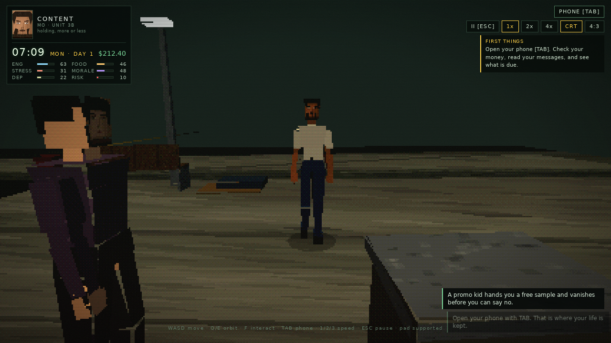

```
Mo has a job, a lease, a phone full of people who want things,
and a habit that has been quietly rewriting his week.
Rent is due on Friday. It is Monday. He does not have it.
```

---

## The phone and the interface

The phone is the management screen: a chamfered brushed-metal shell with a warm, glowing glass
panel, speaker slots, side buttons and a five-app dock. Everything on it is reachable with the
mouse or the keyboard.

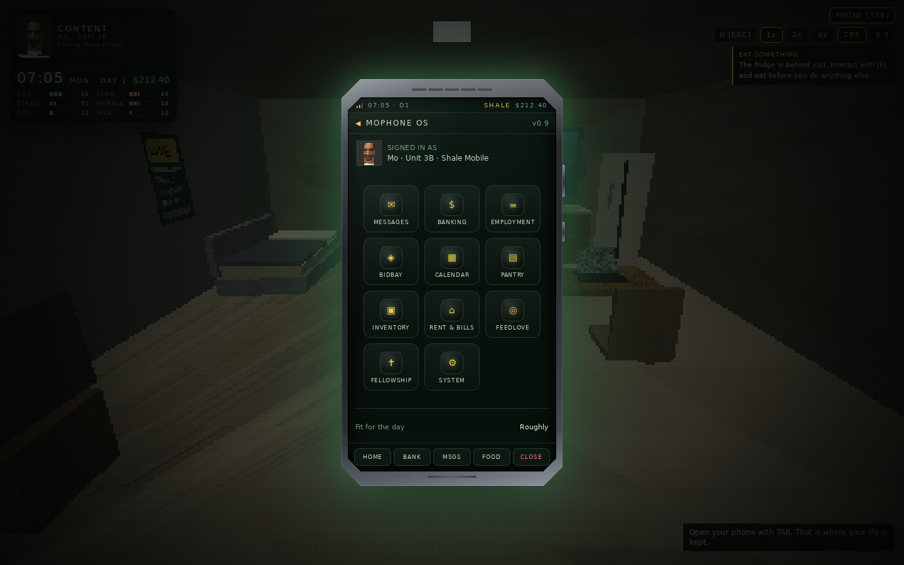

**Themes and scale** live in two places: `SETTINGS` on the main menu, and `SYSTEM` inside the
phone (so you can change them mid-run). Four skins — Functional (CRT green), Amber (warm glass),
Ice (clinic blue) and VHS (magenta bleed) — recolour the phone, the HUD, the menus and every
modal from one set of CSS variables. The interface scale is S / M / L, applied to the in-game UI
layers only, so the 3D stage never shifts. Both are saved with your run.

**The title screen** is a performance rather than a still. Mo stands in the corridor and scans it
slowly — left, hold, right, hold — then reaches into his jacket, brings out a small glass pipe
and smokes while the crowd walks past behind him: neighbours coming home, two of them stopped to
talk, everyone eventually swallowed by the fog. The whole loop runs on a single 26-second clock in
`src/world/title.js`, which overrides the idle pose after `animateMo` so the two can never argue.

**Typography** is part of the shell: Orbitron carries the machine voice (title, clock, money, app
headers, endings) and Chakra Petch carries everything meant to be read as prose. Both are
vendored under `assets/fonts` with their OFL licences, so the interface never waits on a network
font.

**The camera** is adjustable in `SYSTEM` as well: distance (70–140%) and height (80–135%), plus a
reset, saved with the run. The follow camera is a spring arm — it shortens against walls, and when
Mo backs into a corner it swings sideways along the wall instead of tipping the view to a
top-down.

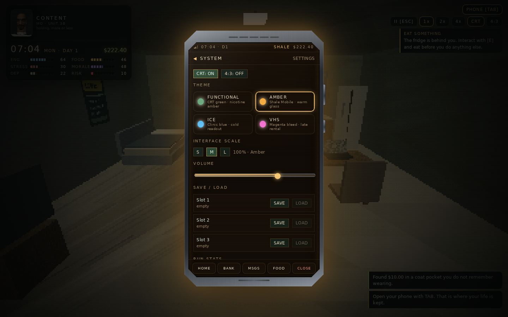

## The block

Kestrel Street is one block, and it is dressed like one: dark towers behind the shopfronts,
fire escapes and a rooftop water tank overhead, vertical neon blades and a bulb marquee at
street level, cars parked at the curb, a crossing with its own traffic light, trees in concrete
planters, a mailbox, a news box, a wall phone, and a steaming grate with the wet patch it leaves
on the walk. It is all built from the same box and plane primitives as the rest of the world, so
it dithers, warps and fogs with everything else in the frame.

## Play it

**Live:** <https://xiondigital.net/mofunctional/> — GitHub Pages, straight from `main`.
**Arcade:** <https://xiondigital.net/arcade/> — the hub tile that launches it.

No install, no account, no backend. Click **PRESS START**, headphones recommended.

The game is a static site. ES modules can't load over `file://`, so to run it from a
checkout, serve the folder:

```bash
npm start                 # python3 -m http.server 8080
python3 -m http.server 8080
npx serve -l 8080 .
```

Then open **http://localhost:8080** and click **PRESS START**.

- Desktop Chrome / Firefox / Safari. Keyboard, or a gamepad.
- Audio starts on the first click (browser autoplay policy).
- Saves live in `localStorage` (3 slots + autosave), scoped to the origin it is served from.

---

## Controls

Movement is camera-relative and positive-forward: **W always walks into the screen**, whichever
way the camera is turned, and Mo turns to face the way the stick points.

| Input | Action |
|---|---|
| `W A S D` / arrows | Move |
| Click / tap the floor | Walk Mo to that spot (a drag still orbits) |
| `Q` `E` | Orbit the camera around Mo |
| Mouse drag | Orbit the camera |
| `F` / `Space` / `Enter` | Interact with whatever is near |
| `TAB` | Phone (pauses time) |
| `ESC` | Pause / close |
| `1` `2` `3` | Speed 1× · 2× · 4× |
| `C` | Toggle CRT scanlines |
| `R` | Toggle 4:3 framing |

**Gamepad** (standard mapping, plugged in at any time — the HUD toasts when it connects):

| Button | Action |
|---|---|
| Left stick / D-pad | Move |
| `LB` / `RB`, `LT` / `RT` | Orbit the camera |
| Right stick X | Orbit the camera |
| `A` | Interact |
| `B` | Phone |
| `START` | Pause |
| `X` / `Y` | Speed 1× / 2× |

The HUD has the same controls as buttons. The phone has its own bottom navigation.

---

## What's in this build

### A cast with one design language

Every character — Mo, Addison, the neighbours, both shopkeepers, the men on the street — is
built the late-90s console way, measured off Mo's reference model (`assets/ref/`): a ~6.4-head,
broad-shouldered figure whose limbs are **lofted faceted tubes** (calf, bicep, chest and the hang
of the tee are shaped by extra rings; every facet keeps a hard normal), with **joint caps** at
knees and elbows so nothing opens up when a leg bends, and a **low-poly skull wearing one
wrap-around face texture**. Mo's head texture is the CONTENT face from his mood sheet; everyone
else's is painted in the same planar style and framing, then wrapped onto the identical skull.

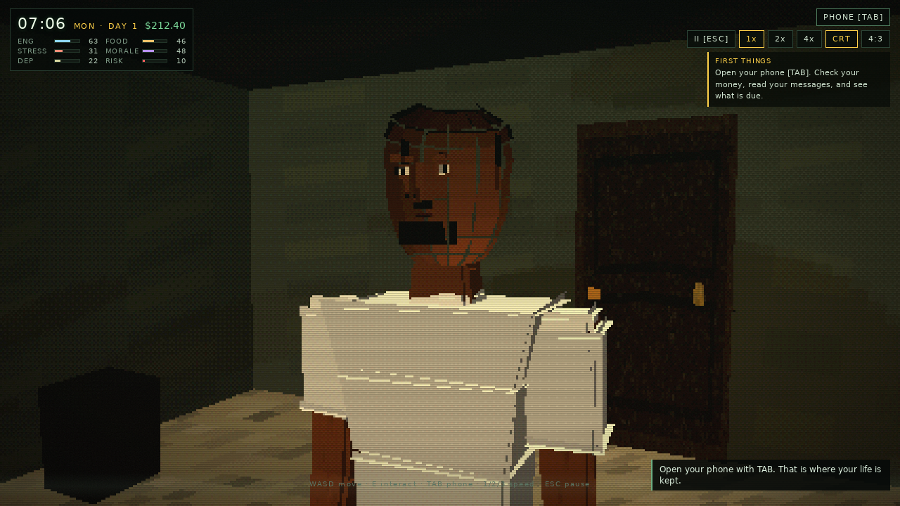

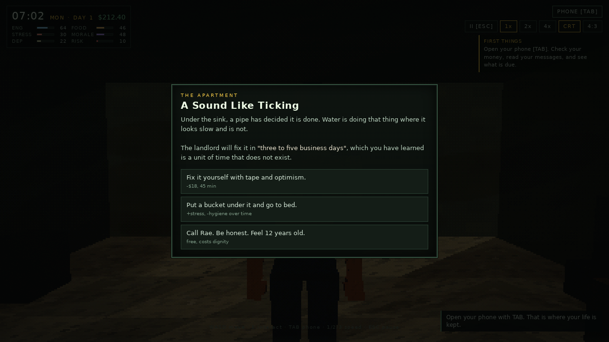

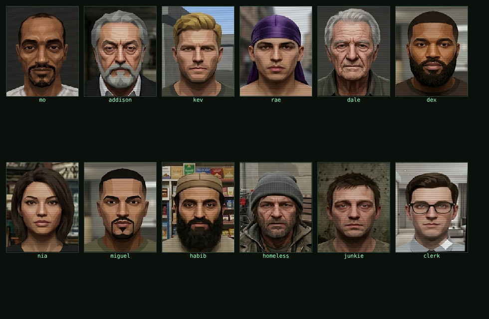

### Mo's face on the HUD, in his current state

The panel top-left is Mo's face from the owner's **mood sheet** (`assets/ref/mo_mood_sheet.png`):
**CONTENT**, **WRECKED** (tired), **STRESSED**, **HIGH**, **SICK**, **SEETHING** (angry), swapped
when his state changes. NPC avatars in the phone and text threads come from the owner's **NPC face reference bank**
(`assets/ref/npc_face_bank.png`), and the same faces are projected onto each NPC's 3D head.

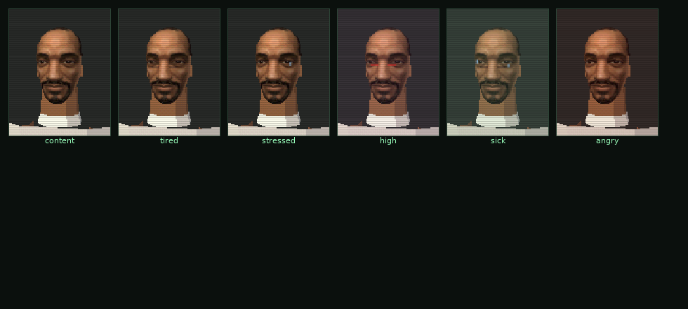

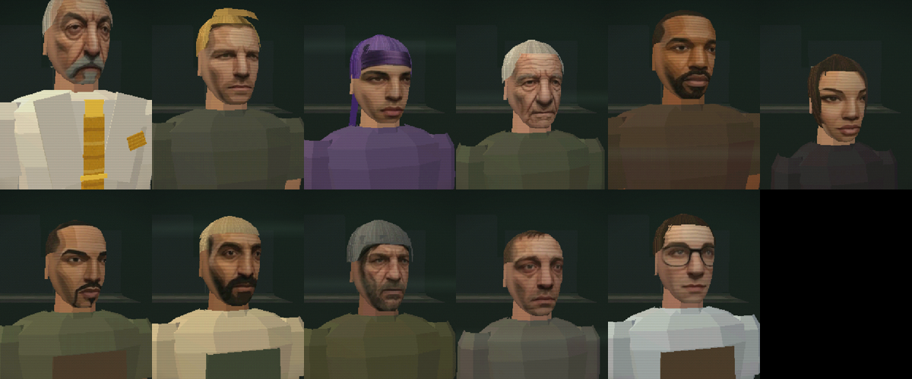

### Text threads that answer back

Incoming messages arrive as an SMS overlay with the sender's face on their bubbles and Mo's face
on his. When a message asks something, the thread waits for an answer — and the option Mo picks is
posted into the thread as a sent bubble, then filed in the phone's Messages app, where the whole
conversation stays readable and repliable.

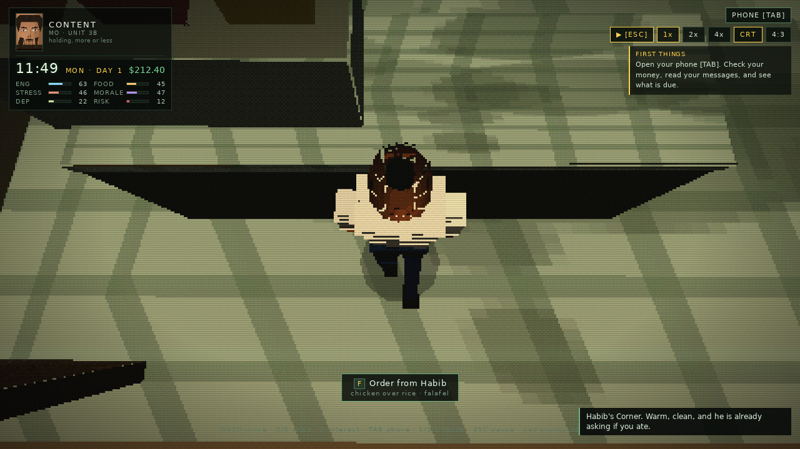

### Kestrel Street, alive

Six neighbours run daily schedules: Dale unlocks the store, works the counter, smokes by the job
board and goes home; Kev takes lunch at the bus stop and drinks on the bench at night; Rae does
her rounds and argues with a contractor; Dex holds the alley after dark; a man named Gus beds down
on cardboard by the bodega and sorts cans in the evening; a man you only nod at drifts between the
bench, the alley mouth and his cart. Random street encounters — panhandlers, a watch guy, a
preacher with gold-edged leaflets, spilled groceries, skate kids, the alley at night — interrupt
with real choices.

### Two counters, two economies

**Kestrel Bodega** (Miguel): bacon, egg and cheese, a chopped cheese, a hero, loosies from under
the register, tall boys from the back cooler. Cheap, salty, pork-forward.

**Habib's Corner** (Habib): halal only — no pork, no loosies — chicken over rice, a combo plate,
lentil soup, falafel and baklava. Roughly a third more expensive, and the food actually restores
him: the halal plate is the best hunger/energy buy on the block, falafel is the cheap option.

| | Bodega | Habib's |
|---|---|---|
| Bacon, egg & cheese | $4.50 · +44 food | — |
| Chopped cheese | $6.50 · +58 food · +11 morale | — |
| Chicken over rice | — | $9.50 · +60 food · +26 energy |
| Halal combo plate | — | $10.50 · +62 food · +27 energy · +9 morale |
| Falafel wrap | — | $4.00 · +36 food · +14 energy |
| Loosies | $1.50 · −9 stress | — (not sold) |
| Tall boy | $2.75 · −12 stress · +5 morale | — |
| Mint tea | — | $1.50 · −5 stress · +3 morale |

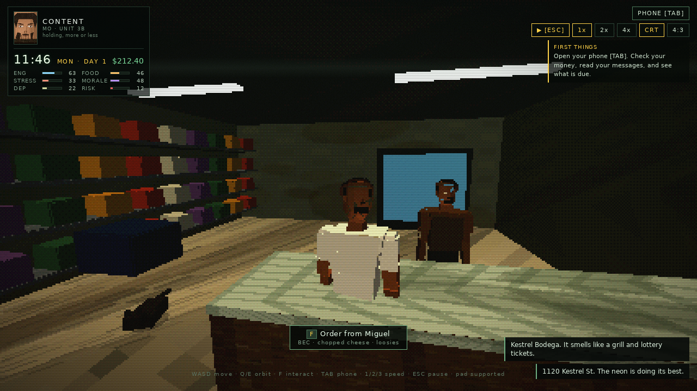
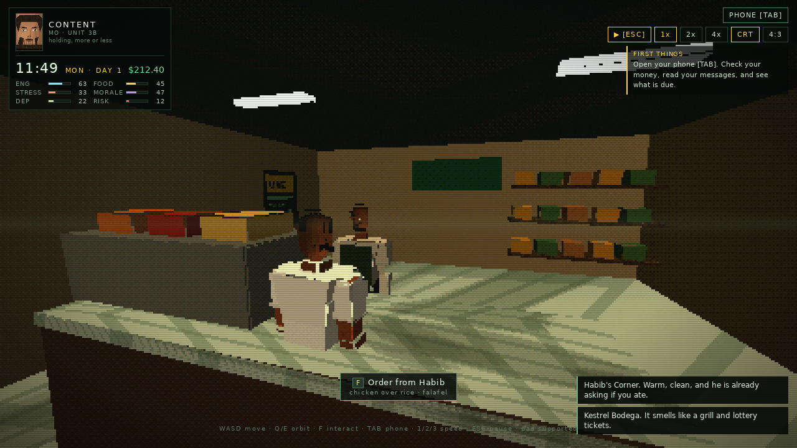

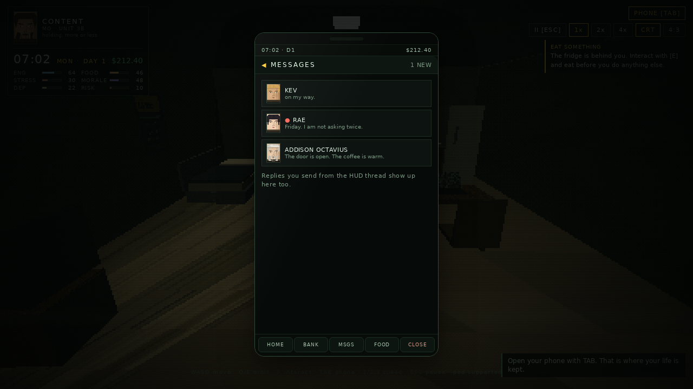
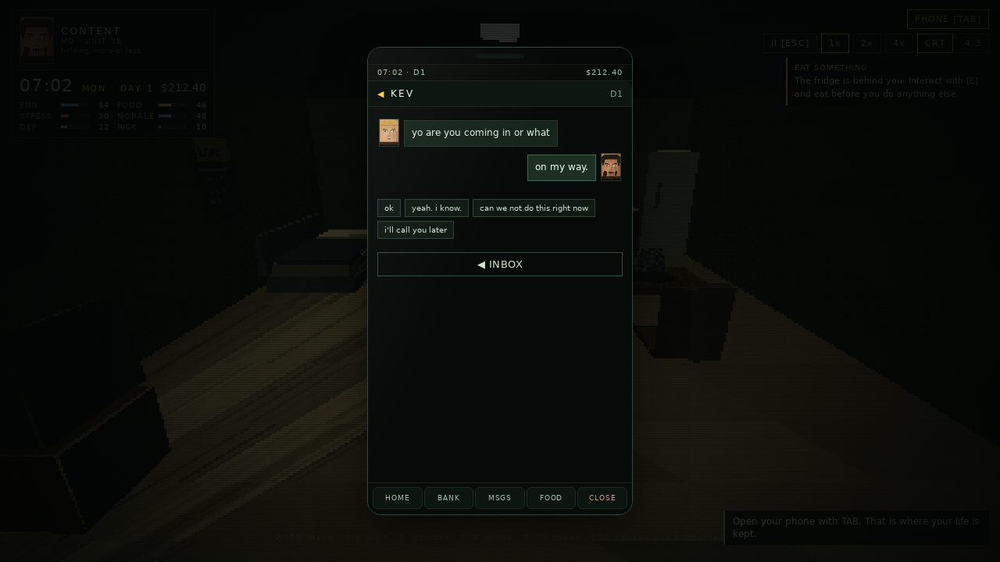

### The rest of the loop

- **Needs** — energy, hunger, hygiene, stress, morale, dependence, risk. Sleep, eat, shower, work.
- **The job** — Quik-Stop #14, shifts, strikes, calling out, quitting, rehire.
- **Rent and bills** — rent, power, phone; eviction after two missed cycles; power cuts.
- **The phone** — banking, employment, BidBay, pantry/CRP credit, calendar, social, Fellowship,
  inventory, saves, settings.
- **The Golden Fellowship** — Addison Octavius, the allowance, the tithe, the pledge.
- **Eleven endings**, from `functional` to `overdose`, `evicted`, `pledged`, `snapped`.

---

## Project layout

```
index.html            page shell, CRT overlay, UI root
styles/main.css       all UI: HUD, phone, threads, menus
src/main.js           game orchestrator: loop, state, flow
src/core/             config (all balance values), state, input, audio, save, util
src/render/           retro renderer (affine UVs, vertex snap, dither), textures,
                      heads (skull + wrap face textures), faces (rendered portraits)
src/world/            characters, areas, shops, schedules, 3D world/camera
src/systems/          needs, economy, jobs, events, street, fellowship, dialogue, endings
src/ui/               hud, phone, threads, modal, menu
scripts/              check-syntax.mjs (parses every module), shot.mjs (Playwright
                      screenshots of the cast/HUD), bake-mo-face.py (reference -> texture)
assets/ref/           Mo's reference sheets (face + full body) — the art-direction anchor
docs/DEVLOG.md        design notes and changelog
```

Balance lives in `src/core/config.js` — costs, rates, wages, stock and thresholds. Gameplay code
reads from `CONFIG` rather than hardcoding numbers.

---

## Notes

- Everything here is fiction. The substances in the game (BLISS, STATIC, MUD, DRIP) are invented
  and described only in mechanical terms — no real-world dosing, sourcing or preparation detail.
- The Golden Fellowship, Addison Octavius, Shale Mobile, Quik-Stop, Kestrel Street, the Civic
  Relief Program and BidBay are original fiction.
- Visual style is an homage to late-90s console rendering: low internal resolution, affine texture
  mapping, vertex snapping, ordered dithering, fog. No platform assets or trademarks are used.
