

# MO: FUNCTIONAL

**You don't have to get your life together. You just have to keep it together.**

A 90s-style dark comedy about rent, shifts, bad habits and the arithmetic of a Tuesday. 
One block in New York. One week until rent. One man who is, technically, fine.

### [▶ Play it in your browser](https://xiondigital.net/mofunctional/)

No download, no install, no account. Saves stay in your browser.

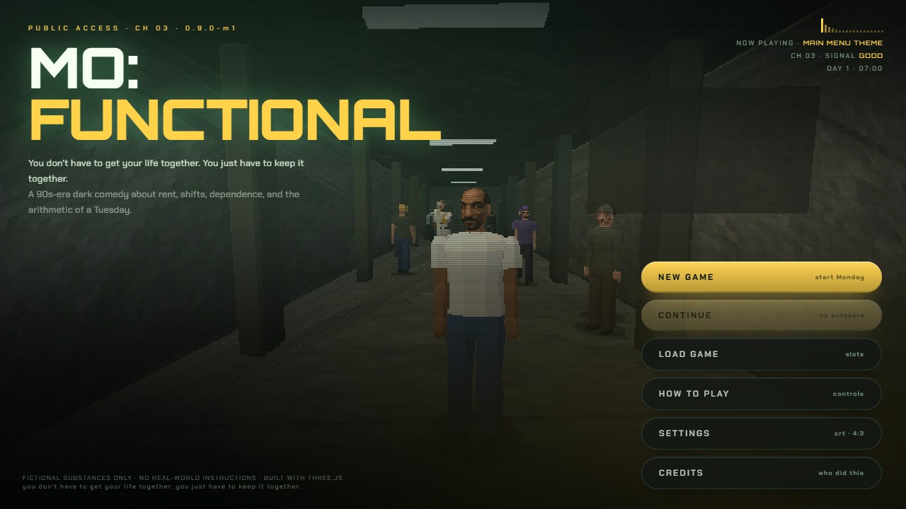

---

## Meet Mo

It is Monday, 7:00 in the morning, and the radiator is making the sound of a man being patient.

Mo lives in Unit 3B at 1120 Kestrel Street. He has a job at Quik-Stop #14, $212.40 in the bank,
a fridge with three days of food in it, a phone full of people who want things, and a habit that
has been quietly rewriting his calendar. Rent is $420. It is due on Day 7. You can probably see
where this is going.

Your job is not to make Mo a success story. Your job is to make him **functional**: fed, rested,
paid up, employed, and still on speaking terms with his sister. Some days that is easy. Most
days it is a negotiation between what he needs, what he wants and what the clock will allow.

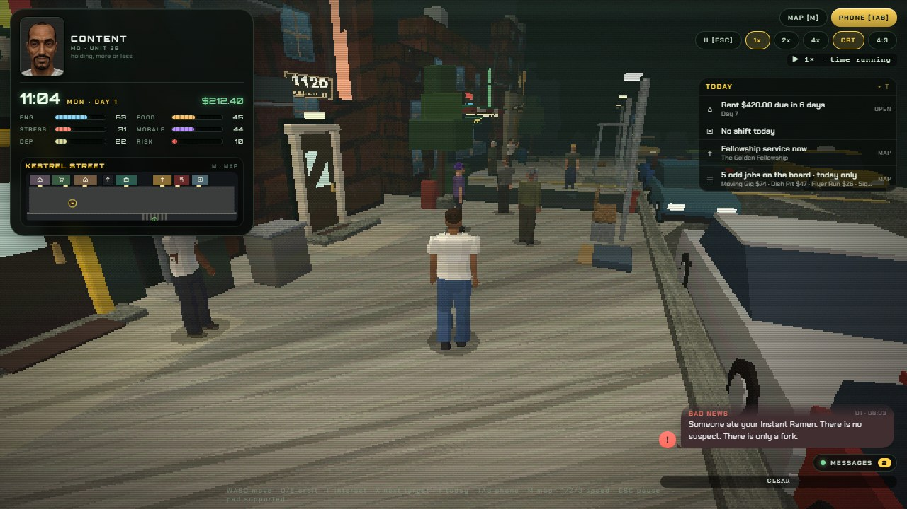

## Why you might like it

- **It looks like a lost 1998 PlayStation game.** Wobbly textures, chunky polygons, scanlines
  if you want them, and a soundtrack recorded at exactly the bitrate it deserves.
- **Every minute costs something.** A shift is eight hours. A nap is three. A falafel is twenty
  minutes and four dollars, and Habib will remind you that you cannot lose money on falafel,
  only time.
- **The block is alive.** Neighbours keep their own schedules, cars honk at you, a kid on a bike
  yells "ON YOUR LEFT" at nobody, and a stray dog named Meatball decides whether you are worth
  following home.
- **Your phone is a whole second game.** More than a dozen parody apps for banking, dating,
  groceries, stocks, a car service and a countdown to rent that feels personal.
- **It is funny, and then it is not, and then it is funny again.** The writing never laughs at
  Mo. It laughs with him, mostly at the bus.

---

## Your first week: a survival checklist

New on Kestrel Street? Follow this and Mo makes it to Day 8 with his dignity mostly intact.

### Day 1 (Monday)

- [ ] **Check the phone.** Press `TAB`. Read your texts, look at your balance in **Shale Pay**,
      and see what is due.
- [ ] **Eat breakfast.** The fridge is in Unit 3B. Walk up to it and press `F`. Food is the
      cheapest stat to keep up, so never skip it.
- [ ] **Read the Today panel** in the top right (`T` folds it). It lists rent, your shift, bills,
      odd jobs and anything you pinned. Click a row and it opens the right app or puts the place
      on your map.
- [ ] **Make some money.** Work your shift at Quik-Stop #14, or grab an odd job off the board
      outside. Being late gets you docked; three strikes and Dale lets you go.
- [ ] **Go to bed at a decent hour.** If sleeping would make you miss something, the game asks
      first.

### Days 2 to 6

- [ ] **Set up AutoPay** in Shale Pay so rent, power and the phone bill pay themselves on the day
      they are due, as long as the money is there.
- [ ] **Sell what you do not need.** The CRT TV, the guitar, the jacket. **BidBay** pays well but
      slowly. Ashby Pawn pays badly but right now.
- [ ] **Keep stress down for free.** Sit on a park bench, shoot around on the half-court, play
      chess against whoever is there, or put on the boombox and dance.
- [ ] **Answer your sister.** Be honest with Nia and she starts coming over with dinner, which
      happens to be the best meal in the game.
- [ ] **Pay the rent.** Day 7 at the latest. If you are flush, you can pay a week early.

### The long game

- [ ] **Stay functional for 30 days:** rent paid, job intact, every bar above zero.
- [ ] **Get clean, if you want to.** Kestrel Clinic runs a five-session outpatient course. It
      competes with your shifts, which is exactly the point.
- [ ] **Build something.** Buy a building, a laundromat, or a few shares of a 1999 dot-com that
      will absolutely be fine.
- [ ] **Find someone.** Three people on the block can be dated, and they each have opinions about
      your hygiene.

---

## Ways to start

The intro asks how the week begins. **Default** is the week as it comes. **Fresh Start** covers
the rent but not the job. **Final Warning** keeps the job by one strike. **Family First** has more
money and a list from Nia. **Bad Week** starts with a plumber's bill and closing shifts.
**Getting By** is gentler, with rent covered and a little saved.

---

## What "Functional" means

The HUD tracks how Mo is doing. Keep these out of the red and he can handle almost anything.

| Bar | What it is | How to keep it up |
|---|---|---|
| **Energy** | gas in the tank | sleep, coffee, a real meal |
| **Food** | how long since he ate | the fridge, the bodega, Habib's, Nia's cooking |
| **Stress** | how close he is to snapping | the park, music, a good conversation, a clean apartment |
| **Morale** | whether he believes tomorrow will be better | small wins, people who like him, dancing badly |
| **Dependence** | how much the habit runs his week | time, the clinic, the outpatient course |
| **Risk** | how close he is to a very bad night | not pushing his luck after dark |

Let a bar bottom out and Mo can collapse. He wakes up hours later, beside his own bed or at the
clinic, short on time and money and in exactly the state that put him there. The game does not
end. It just makes Monday harder.

> **Tip:** Time stops whenever the phone, a shop, the map or a dialog is open. Take as long as
> you like to think. The block will wait.

---

## A tour of the neighbourhood

The street has a life of its own now. People walk past eating a slice, sipping a coffee, on the
phone, carrying bags, pushing a stroller, leaning on a cane, reading the paper; two of them will
stop to talk and carry on; somebody turns into the bodega and comes out with a bag. Now and then
something happens without Mo: a bag gets snatched (one punch and the thief is down), a cruiser
pulls over and two officers make an arrest, or at night two writers paint a piece on a wall that
stays there. Papi hears about all of it.

  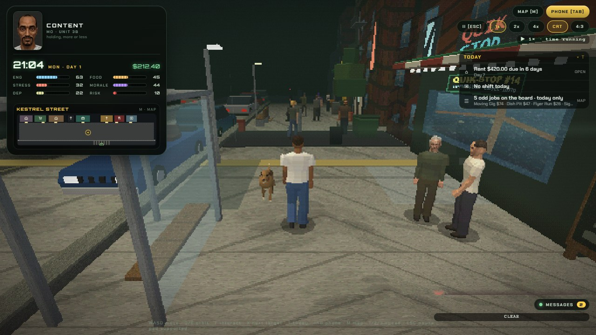
  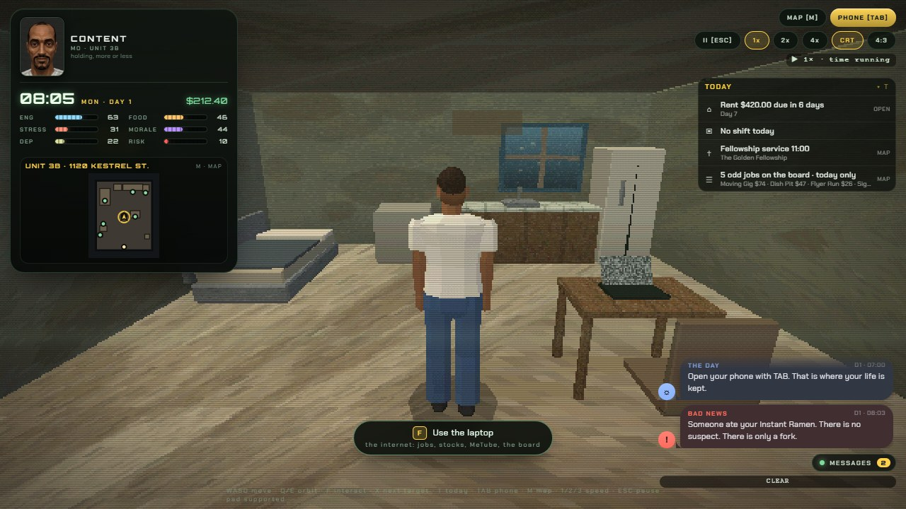

| Place | Why you go there |
|---|---|
| **Unit 3B** | Home. Bed, fridge, TV, a closet, a laptop with the whole 1999 internet on it, and Chairman the cat. The bathroom has a shower that has never worked (so Mo washes at the sink) and a toilet tank where a stash stays out of his pockets. |
| **Quik-Stop #14** | Work. Open 24 hours. Dale opens, Kev complains, the coffee is exactly as good as it costs, and the public restroom in the back has two stalls and one working tap. |
| **Kestrel Bodega** | Miguel's. Two aisles, a bread rack, the grill, and a cat asleep on top of the lottery machine. Scratch-offs, tonight's numbers, or just scratch the cat. |
| **Habib's Corner** | Halal, no pork, no nonsense. Chicken over rice that fixes most problems. |
| **Kestrel Clinic** | Nurse Okafor, walk-ins welcome. Treatment on cash or on the bill, and she will not judge you out loud. |
| **Kestrel Park** | Across the crosswalk. Benches, a half-court with a bent rim, chess, and a boombox somebody left a tape in. |
| **1104 Kestrel St.** | The five-floor walk-up next door. Arguing neighbours, soup on three, a man selling things from his coat on four, and a roof. |
| **The Golden Fellowship** | Sunday service with Addison Octavius. They will help Mo. That is what worries us. |
| **Ashby Avenue** | One bus ride away: the newsstand, Lucia's trattoria, the 84th Precinct, Dee's Wash & Fold, and **Ashby Pawn & Gold**, where Benny in his palm-tree shirt buys and sells anything that is not food or drugs. The sax player on the corner plays the whole soundtrack in order if you stand and listen. |
| **Kestrel St station** | Down the green-railed stairs on Kestrel or on Ashby. The platform runs under both, so it is also the short way between them. |

  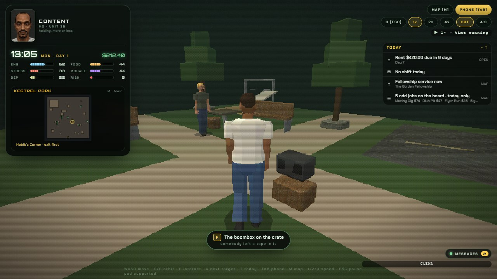
  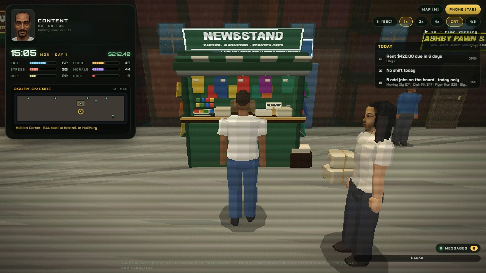

Every door is lit and signed, every shop keeps real opening hours, and the bodega closes when the
bodega closes. Plan accordingly.

**Take a seat.** Every bench, pew and chair can be sat on: walk up, press `F`, and Mo sits down
for real. A sit takes the edge off stress and gives back a little energy. Walk off to stand up.

## Under the street: the K train

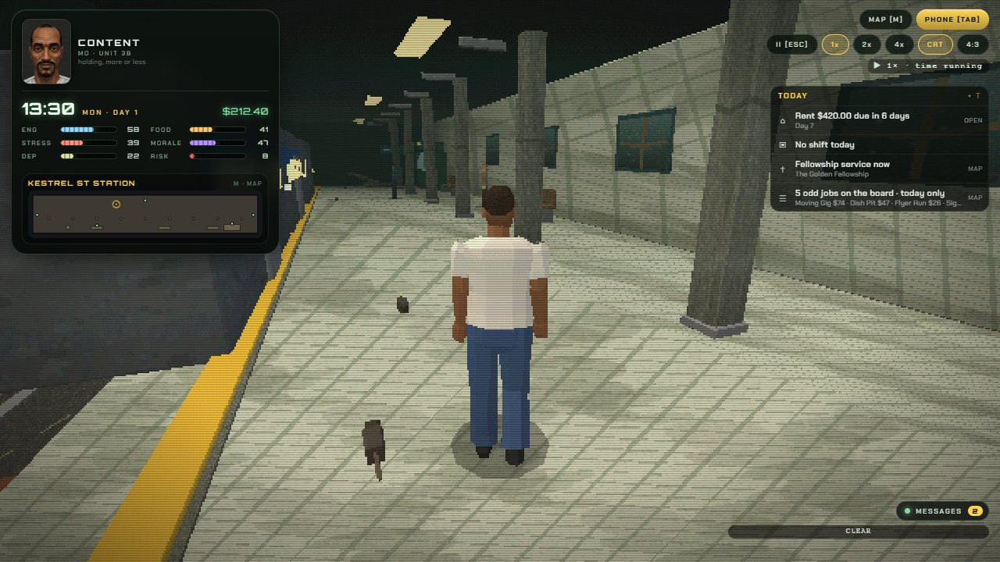

Take the stairs at the west end of Kestrel or the east end of Ashby (green railings, a white globe
on each post) and you are on the platform: steel columns, tiled walls, a token booth, a man
asleep on a bench and a rat walking the edge like it paid the fare. The **K local** pulls in,
stops, opens its doors and waits a few seconds. Stand near the edge and press `F` to board. The
express on the far track does not stop for anybody, and you will feel it go by.

| Stop | What is there |
|---|---|
| **7 Av · Park Slope** | Brownstones and strollers. Grounds for Hope pays cash for a dishwashing shift, and the dog-walker board pays for two hours with three very good boys. |
| **Fulton St · Downtown** | Mr. Jay's, a real store with racks, a sneaker wall and Jay at the register. The Civic Relief office, where every chair is taken and window 3 recertifies your food credit once the line ahead of you clears. Ready Hands day labor, and a hot dog cart that is never wrong. |
| **Kestrel Houses** | Towers around a courtyard and a fenced half-court with a pickup game running. High risk, high reward. More on that below. |

A ride is $1.50, and the car has its own entertainment.

  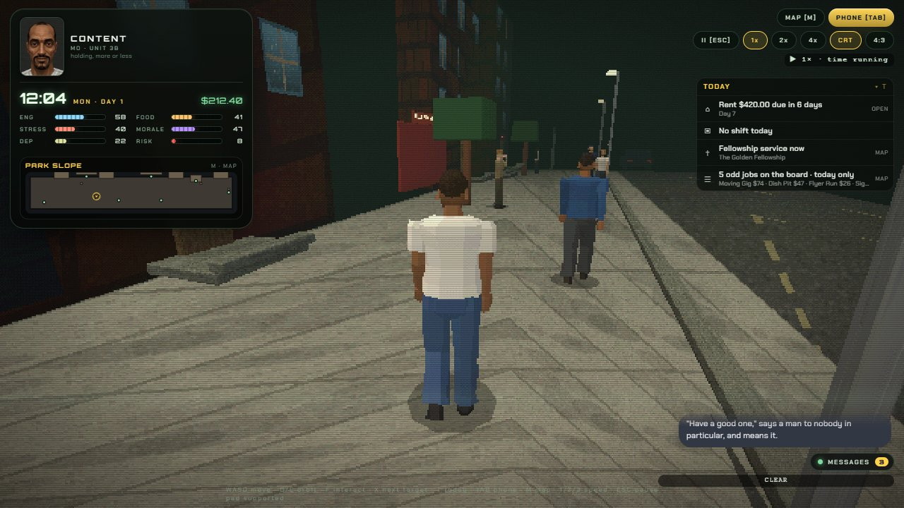
  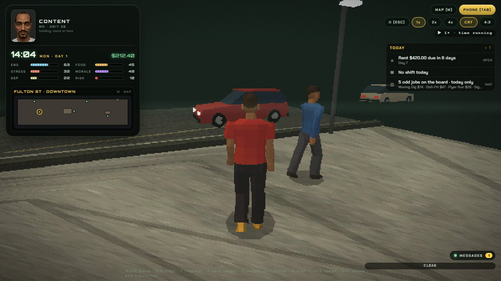
  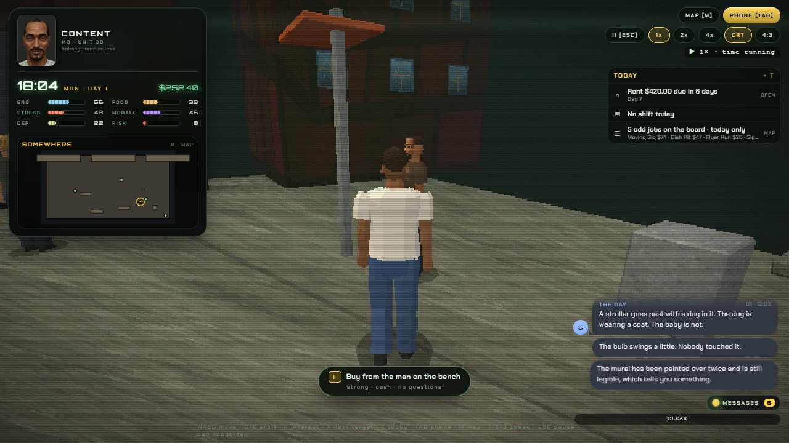

### Dressing Mo

Whatever you buy at Mr. Jay's waits in the **closet** in Unit 3B, where Mo can change into it:
flannel and boots, a jersey and fresh white sneakers, a sweatsuit, an army jacket. His face and
hair stay his own. Short on time? A dollar at the newsstand buys Jay's catalog, and the order
line in Contacts has the outfit folded in the closet by ten the next morning.

### People on the street

The block has its regulars, and some of them want a word. The man in the long coat with a
"Rolex" for forty dollars, a panhandler with a cup, a man with a leaflet with a gold border, a
woman whose grocery bag just split: they come up the sidewalk, stop a step away and wait. Walk
over and press `F` to talk, or keep walking and they give up and go. Things Mo only sees (kids
on a curb, an argument over a stroller) are a line in the feed, and nobody comes round twice in
a day. People who would text Mo (Kev, Nia, Dale) text him, and he answers from the thread.

---

## The MoPhone

Press `TAB`. Everything Mo does with money, people or plans goes through here.

  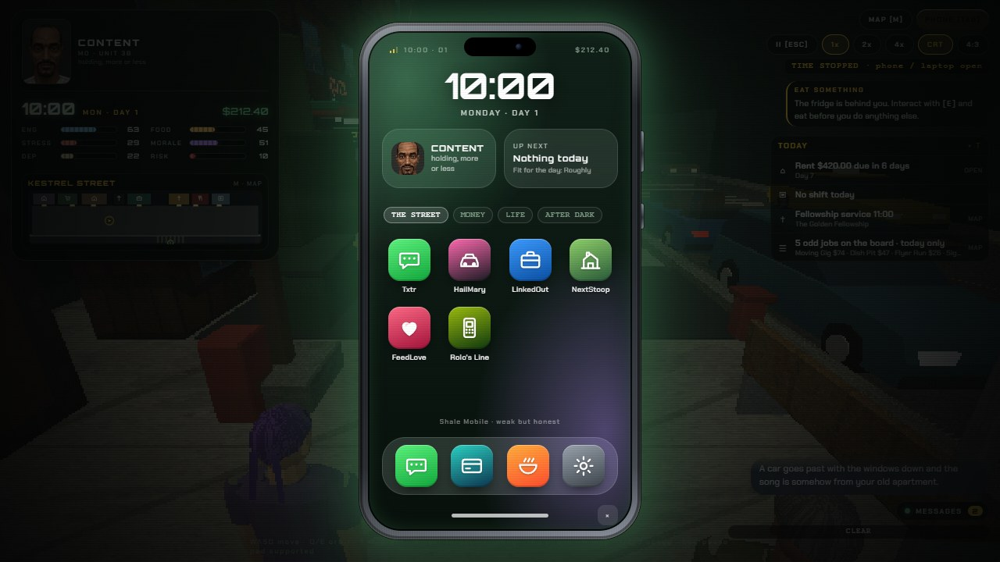
  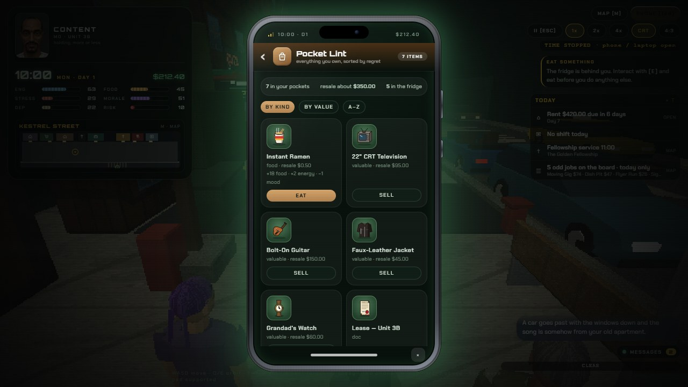
  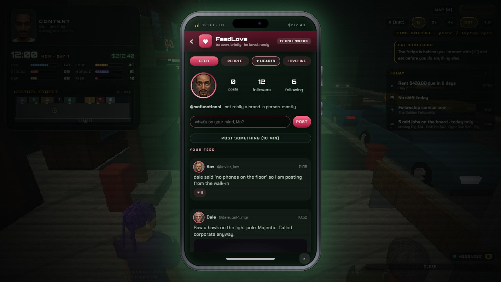

| App | What it does for you |
|---|---|
| **Txtr** | Your texts. People answer in their own voice, threads stay in one place, and pictures open full screen. |
| **Phone** | Contacts and a keypad. Call Mom, ask Nia over, talk Kev into the park, book the clinic, order delivery, or dial 911 and get a cop on the block for two minutes. Some numbers are worth guessing. |
| **Shale Pay** | Your bank: balance, bills, history and AutoPay. |
| **LinkedOut** | Your shift, your strikes, and odd jobs for cash today. |
| **Pocket Lint** | Everything you carry, sortable by kind, value or name, with what it would sell for. |
| **GrubHope** | Groceries and the Civic Relief Program, if you have your ID and lease. |
| **BidBay** | Sell your things to strangers on the internet, slowly, for real money. |
| **iDread** | The week ahead, your pinned goals and sleep. |
| **Landlordly** | A thermostat dial that counts down to rent. Very calming. |
| **FeedLove** | Post, take selfies, lip-sync to the hits, read the comments, tap a stranger's face to see who they are, and argue with them if you must. Its LoveLine tab tells you who is waiting on you. |
| **NextStoop** | The neighbourhood gossip board. Surprisingly good at telling you where people are. |
| **HailMary** | A car service. Ask for a ride up the block and the driver will tell you to walk. |
| **TradeHarder** | Stocks from 1999 and real estate on Kestrel Street. |
| **Amazin'** | Order things, they arrive tomorrow. |
| **Blessed+** | The Fellowship's livestream. Give any day of the week: a gift pays your tithe first, then counts toward your standing with Addison. |
| **Snapz** | The camera. Photos, selfies, and memories you unlock along the way. |
| **Square Up** | Who owes who: money, a favour, an apology, a shift. Pay it, do it, or talk about it. |
| **Tweaks** | Skins, scale, wallpaper, clock, notifications, sound and saves. |

The home screen has tabs (Street, Money, Life, After Dark) and an ALL drawer with every app in
it, or one page of everything if you prefer. Snapz is the camera: take photos and selfies, and
put any of them behind the home screen. Some pictures you have to earn, and they appear in the
roll on their own: Chairman, the dog, a girlfriend, a first shift, a childhood photo with Nia, a
booking photo, a good suit. LonelyFans pictures arrive as texts, mosaic
where it counts, and one of the women will only pose with her cat.

There are seven colour skins (Functional, Amber, Ice, VHS, Primo, Bodega and Graphite), and the
same apps run on the laptop in Unit 3B, alongside a 1999 video site, an anonymous message board
and a very slow dial-up connection.

---

## Food, shopping and the fridge

Walk into the bodega or Habib's and you get the menu board: the owner, his opinion, and a card
for every item with its price, what it does for Mo and how many he already has. Click to buy.
The board stays open so a breakfast run is three clicks, not three trips.

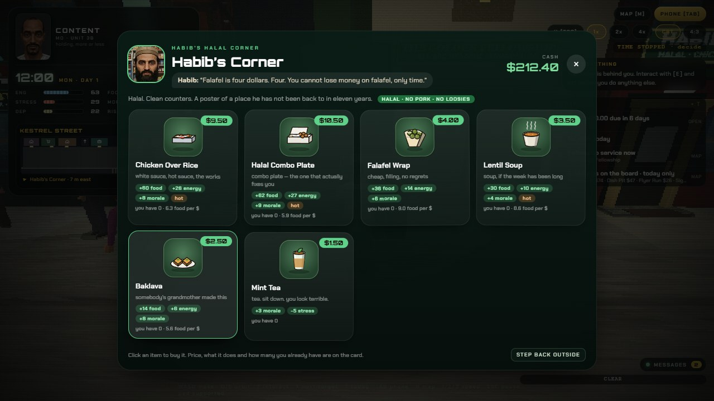

### Myrtle Row

Walk west past the 1104 walk-up and Kestrel turns the corner into **Myrtle Row**, the side street
that runs through to Ashby Avenue. It is where the block eats: Sal's Famous sells slices, whole
pies, sodas and Italian ices through a window onto the sidewalk; Don Cheo pushes his piragua cart
up and down the Row (catch him to buy); Desmond's Irie Grill does beef patties, coco bread and
jerk chicken off an oil drum; there are two carts for hot dogs and pretzels, Mendel's knish table,
and the Istanbul Grill with a döner turning on the spit. Bagels with cream cheese are now at the
bodega and the Quik-Stop too. Mo eats every one of these on screen.

- **Food per dollar** is printed on every card. The falafel wrap is very hard to beat.
- **The fridge** holds 24 items. Store all your food in one click on the way in, take what you
  need on the way out.
- **Eating happens on screen.** Mo takes real bites, and the bars ease up as he chews.

---

## Getting around

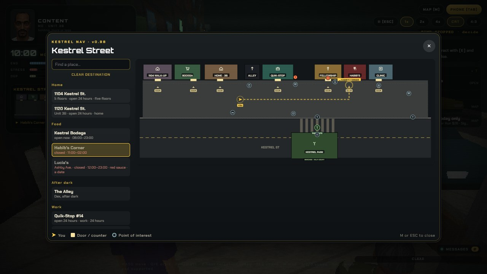

- **The map** (`M`) lists every place by category with its hours. Pick one and you get a route on
  the street, a ring on the minimap and a heading like "Habib's Corner · 7 m east".
- **The prompt** at the bottom of the screen tells you what `F` will do, and why it will not when
  something is closed. With several things in reach, `X` picks the next one.
- **The B44 bus** runs to Ashby Avenue from the stop on Kestrel. HailMary is faster and judges you,
  and if you take too long to reach the curb it pulls off. Run for it and you might still catch the
  door.
- **The K train** runs under Kestrel and Ashby, and out to Park Slope, Downtown and Kestrel Houses.
- **Speed up time** with `1`, `2` and `3`. The game warns you if something is due within the hour.

---

## The people on the block

- **Nia**, Mo's sister, texts and calls. Talk to her properly and she comes over with dinner.
- **Dale** runs the Quik-Stop and keeps track of every minute you are late. **Kev** works the
  register next to you and has opinions about everything.
- **Miguel** and **Habib** run the bodega and the halal spot, and both of them notice when you
  have not eaten.
- **Rae Vell**, the landlord, does his rounds with a clipboard. You will learn the sound of it.
  Put him on the pavement and the lease becomes negotiable: cheaper rent, or repairs on his dime.
- **Stephanie, Melanie and Diana** each keep their own day all over the block. A small heart over
  someone's head means you could try, not that she is interested. Dates cost real money and real
  evenings, and a bad one does not refund. Each of them has a home (Stephanie in 1B, Melanie at
  1104, Diana in a Park Slope brownstone), and a girlfriend who is sure of you hands you a key: her
  couch, her bed and her fridge are yours to use. Stephanie will get high with you on her couch (or
  yours, once she moves in), Melanie dresses you in clothes no store on the block sells, and Diana
  looks after you, especially once she lives with you.
- **Nurse Okafor** runs the clinic, and something else besides. If you work out who HelloNurse69
  on LonelyFans is, she would like that kept quiet, and she makes it worth your while.
- **Meatball** is a stray. Feed him twice a day and he starts following you. Earn his trust all
  the way and he will have your back after dark.
- **Addison Octavius** leads the Golden Fellowship. He is very kind, and he would like a tenth of
  everything you earn.

---

## After dark

The block changes at night. The alley has a man named Dex who only appears after 18:00, the dice
game sets up at the lot, cops walk the park, and somebody in a grey hood might want your wallet.
You can pay, run, or fight with a timing meter, and a loyal dog changes the odds.

### Throwing hands

Press `Z` and Mo throws a punch at whoever is closest. The block reacts the way the block would:

- **Most people run.** Some square up and swing back. Dealers and hard cases always do.
- **Knock somebody out** and you can go through their pockets. They get up again in a couple of
  minutes, and they will remember your face.
- **Shopkeepers do not fight.** Hit one enough and they pick up the phone, and a cruiser finds
  the block a few minutes later.
- **Cops** take a punch personally. A sober, rested Mo can outrun one. When one catches him, he
  can go quietly or resist on the Fight meter: win and the cop is on the ground, lose and the fine
  is bigger.
- **Somebody who comes at you** (a mugger, a driver out of his car, a Guardian Angle) is a real
  fight: he squares up and swings, you answer with `Z`, and stepping back as he winds up makes him
  miss. Walk far enough away and he gives up.
- **Children are off limits.** Mo has done a lot of things. Not that.
- **Meatball** will forgive a kick eventually. He will not forget it soon.

And a word to the wise: using anything inside the 84th Precinct is exactly as good an idea as it
sounds.

### The Tunnel

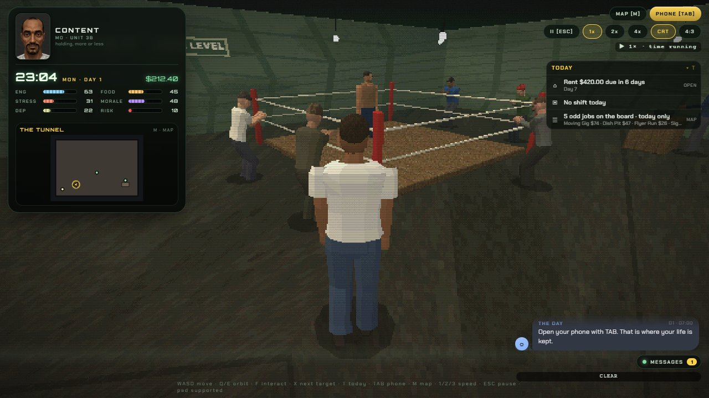

After 22:00, the door on the platform marked AUTHORIZED PERSONNEL opens onto an abandoned lower
level, a ring made of pallets and rope, and a bookie with a cash box. One fight a night. Knock
the other man out and the purse is yours, and it grows every time you win. Get knocked out and
you wake up at the clinic with a story nobody believes.

### ROX

With a hot plate, a box of baking soda from Miguel's, a bottle of water, anything he is holding
and two hours with a towel under the door, Mo can cook **ROX**: little off-white rocks, the
strongest high in the game and the worst idea in it. Smoking it shows on his face.

ROX is also money. Benchy and Squeak at the Kestrel Houses and Dex on the block will move it on
consignment and text every morning with how it went, sending Mo's cut to Shale Pay. The market
moves day to day, and when it moves too well a man can decide the money is his now. A text might
fix that. Standing very close might. Finding him and putting him on the pavement always does.

After dark, **fiends** turn up on the block, in the park and on the platform, swaying and paying
well. They vanish at the first sight of a uniform or a red beret. By day the ones with nowhere to
go are asleep in the Houses stairwells, and they will not buy, but they do have pockets.

### Kestrel Houses at night

The man on the bench sells the strong stuff, posting up on a bench can turn into lookout work,
and after dark somebody will walk up and ask what you are doing there. Sometimes he lifts his
shirt to show you why you should answer carefully. Paying is safe, walking away is a gamble, and
fighting a man with a gun can end the run for good (you go back to your last save). Beat one
anyway and his pockets are yours. The gun stays where it fell. Mo has his reasons.

The towers are open, too: six floors of stairs (the elevator is a rumour), neighbours behind
every door, and on a few floors a woman leaning on her door frame after dark, smoking, with
prices she says like a menu. To find them, read the lobby mailboxes, ask the lady in the lawn
chair, or look for the one smoking outside her tower after five. Pay, and the screen goes dark for an hour; you come to at the foot
of her bed with her line about the dresser. Nothing is shown, and once in a while something is
caught, with nobody to text about it. The half-court in the courtyard is fenced on four sides
now, with a gate on the west end, a real hoop and four regulars running two-on-two. Ask for
next if your knees are up to it.

Some nights are better spent at home with the door locked and a bowl of instant ramen.

Shifts can be played instead of skipped: four things happen at the counter, from a short drawer
to a kid walking out with a honey bun, and how you handle them counts for a little, never for
everything.

1120 Kestrel has a lobby now, with Rae in 1A, and three floors: Stephanie on the first, Kev on
the second, Mo and his neighbours on the third. The stairs take a few minutes, the elevator takes
one. The last flight goes up to the roof, where the door alarm has never worked, the city goes
all the way round, and a few minutes at the edge buys back some quiet. The walk-up at 1104 has a
roof too, alarm notice and all.

Unit 3B can get better. Fix the shower, buy a mattress, put a hot plate on the counter, drag a
couch in from the curb, and with the Home Decorator's Guide from the newsstand, go further:
wood floors, an exposed brick wall, a sectional, a tall mirror, drapes in any colour you like,
and a flatscreen over a ribbed cabinet. Once the guide is on the desk beside the laptop, every
upgrade is ordered from there. The TV has nine channels of nonsense (the news, home shopping, a
pigeon documentary, a cooking show, wrestling, a cartoon, a soap, a televangelist and static),
an off switch, and an hour to lose. The flat shows it. Your door opens onto the third-floor hall now, where the neighbours live and where
the building can be organized: collect complaints, log the heat, hold a meeting, and go to Rae
together.

The block has its own weather: blackouts, heat waves, the trains down, a block party, a building
inspection. Most of them come with a warning and a few ways to get ready, and a marquee runs
across the top of the screen while they last.

There is a music route for anybody with a notebook: write, record around the vacuum upstairs,
burn ten CDs, and play Thursday's open mic at Lucia's. People have stories that take a few days
(Kev, Nia, Habib, Gloria in 4B, Dale), and recovery has more to it than appointments: a support
contact, evening routines, invitations you can leave early, and a way back after a bad night.

Out front of Habib's, Yusuf smokes a hookah at a little table and will share it if you sit.
Outside the bodega, Papi and Tito play dominoes all day, and Papi knows everybody and everything
on the block: ask him about a person, a place, or what is going on this week. Do not take a swing
at either of them.

Things to know about the street. The machines at Dee's give up a can if you hit them right.
Cars do not like being punched, and some drivers get out. On Fulton you can step into the road,
and a car doing sixty will not always stop. Knock down five innocent people in five minutes and the
Guardian Angles come looking, red berets first. Cops only come for what they see. Meatball will walk into the park with you once he trusts you, and
he does not like muggers. Or at
Dee's Wash & Fold, where a quarter buys a round of Eviction Snake, Pac-Mo: Debt Eater or Roach
Invaders on the cabinets by the dryers.

---

## Controls

Movement is camera-relative: `W` always walks into the screen. Click the floor and Mo walks there.

| Key | Action | Gamepad |
|---|---|---|
| `W A S D` / arrows | Move | Left stick / D-pad |
| `Q` `E` / mouse drag | Turn the camera | Bumpers, triggers, right stick |
| `V` | Reset the camera behind Mo | R3 |
| `F` / `Space` / `Enter` | Interact, confirm | A |
| `X` | Next thing in reach | X |
| `Z` | Throw a punch (or a kick, if it is the dog) | L3 |
| `TAB` | Phone | B |
| `M` | Map | |
| `T` | Fold the Today panel | |
| `1` `2` `3` | Time at 1×, 2× or 4× | Y (2×) |
| `C` / `R` | CRT scanlines / 4:3 frame | Back (CRT) |
| `ESC` | Pause, or close what is open | Start |

Every key except `TAB` and `ESC` can be remapped from **ESC → Options**, which also has music and
sound effect volume, camera distance and height, and the full controller reference.

### Learning the ropes

A new run opens with a short illustrated guide: where to clock in at the Quik-Stop, how the LIVE
board on the sidewalk lists today's odd jobs, LinkedOut on the phone, Pocket Lint for everything
in your pockets, food and the fridge, and what the party favors cost. Every page is in **How To
Play** on the title screen and the pause menu, with the full controls on the last one.

### On a phone or tablet

On a touch screen the game puts a thumbstick on the left and buttons on the right (interact,
next, punch, phone, map, pause). Drag anywhere else to turn the camera, or tap the floor to walk
there. The HUD folds itself down to make room for your thumbs.

### Language

MO: FUNCTIONAL speaks **English** (the default), **Español** and **Deutsch**. Pick one from
**Settings** on the title screen, from **ESC → Options**, or from **Tweaks** on the phone; the
change is instant and the game remembers it. Menus, the HUD, the phone, texts, dialogue and
every message switch language. The world itself stays put: street signs, shop fronts and
posters on Kestrel Street read the way they always have, and so do the names of people, places
and apps.

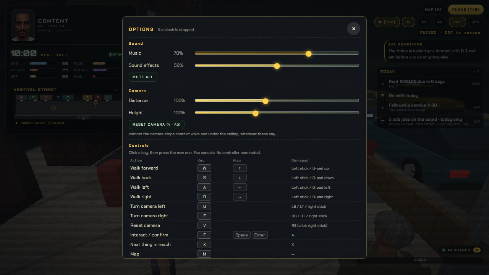

---

## Tips from the block

1. **Eat before you do anything else.** Hungry Mo is slow Mo, and slow Mo is late Mo.
2. **Pin your goals in iDread.** They show up in the Today panel, and Future Mo will thank you.
3. **The park is free.** So is chess. So is the boombox. Stress is expensive; use them.
4. **Opening hours are real.** The bodega closes at 23:00, Habib's at 2:00. The Quik-Stop never
   closes, which is both a comfort and a warning.
5. **Do not trust a deal that sounds too good after midnight.** It is not.
6. **The Tunnel pays, the clinic charges.** Fight rested or do not fight.
7. **Sell the TV.** You were never going to watch it.

---

## Credits

MO: FUNCTIONAL is developed by **XiØN** ([xiondigital](https://github.com/XiONDiGiTaL)).

Inspired by 90s-era console games, life in New York, and circumstances that people in the inner
city know all too well. Built with Three.js and plain JavaScript, with an original soundtrack
written for each place on the block.

Want to look under the hood, run it locally or poke at the debug tools? See
**[docs/DEVELOPERS.md](docs/DEVELOPERS.md)**.

## Disclaimer

MO: FUNCTIONAL is a work of fiction about life choices, work and life balance, time management, money, and what a week costs when it gets away from you. Every character, business, and place in the game is invented. The substances in the game are fictional and are described only by what they do to the numbers.

MO: FUNCTIONAL does not single out, discriminate against, or hold ill will toward any individual or group based on their background, ethnicity, nationality, culture, religion, profession, lifestyle, or personal circumstances. The game is not intended to represent or stereotype any particular community. Its setting, atmosphere, characters, and humor are inspired by fictionalized depictions of New York City life, personal observations, creative influences, and cultural experiences. Any similarities to real people, places, businesses, or events are coincidental. The intention is to portray an imperfect, chaotic, and often absurd environment through fictional storytelling and dark humor, not to ridicule or condemn the people who live in it.

In real life, drug use is not okay and this game does not condone it. If you or someone you know is struggling with substance use, please reach out for help. In the US, the SAMHSA National Helpline is free, confidential, and open 24/7 at 1-800-662-4357. Elsewhere, contact your local health service or a doctor.

The game contains mature themes, including addiction, crime, and adult relationships. Nothing explicitly graphic is ever shown.
