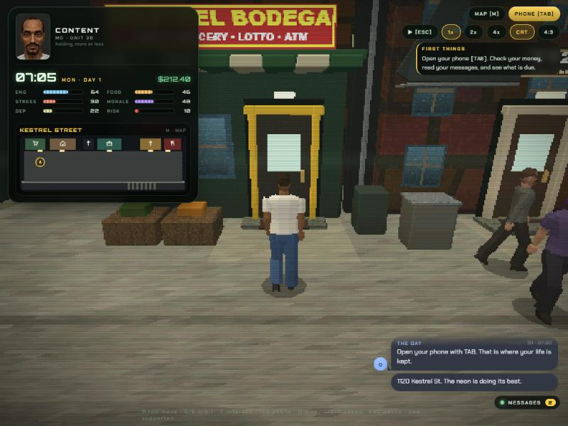
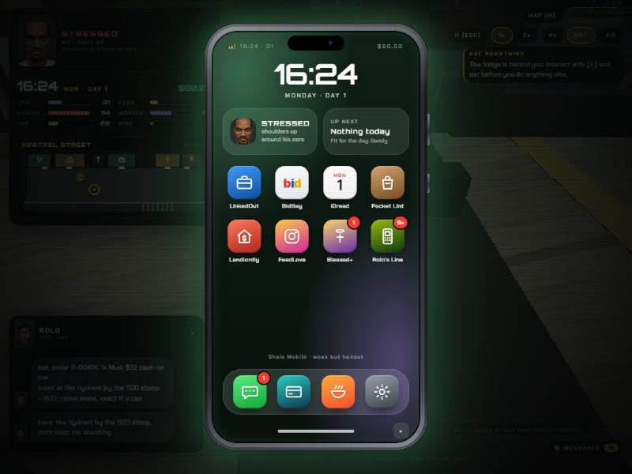
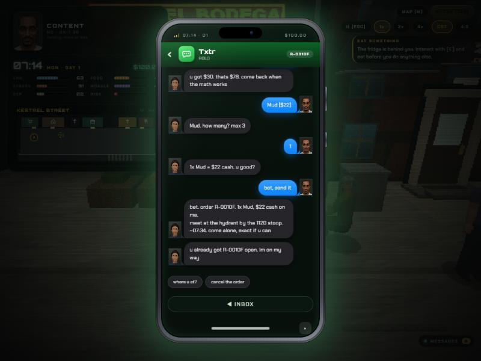
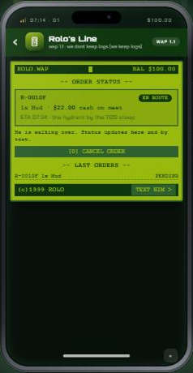
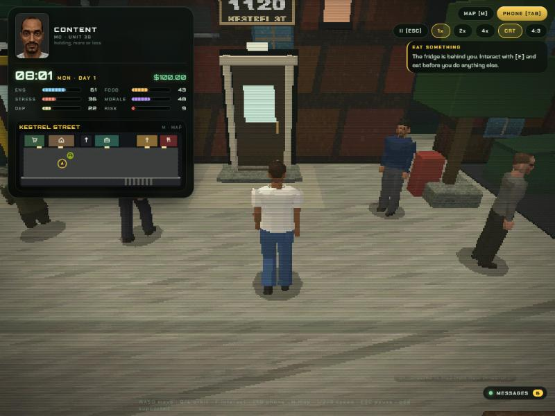
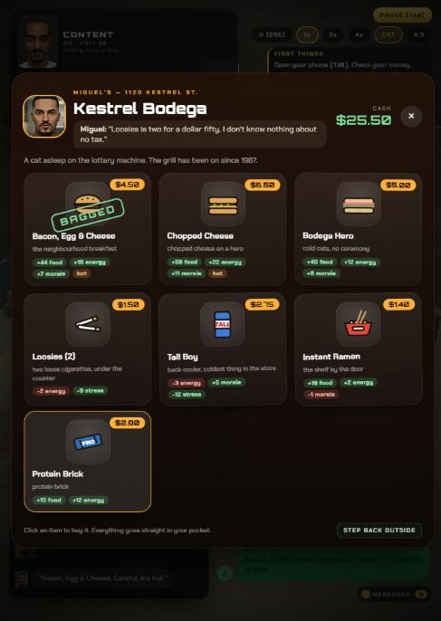
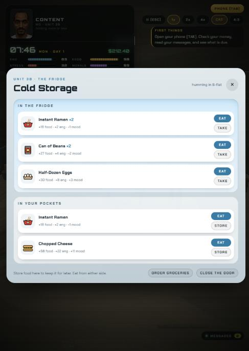
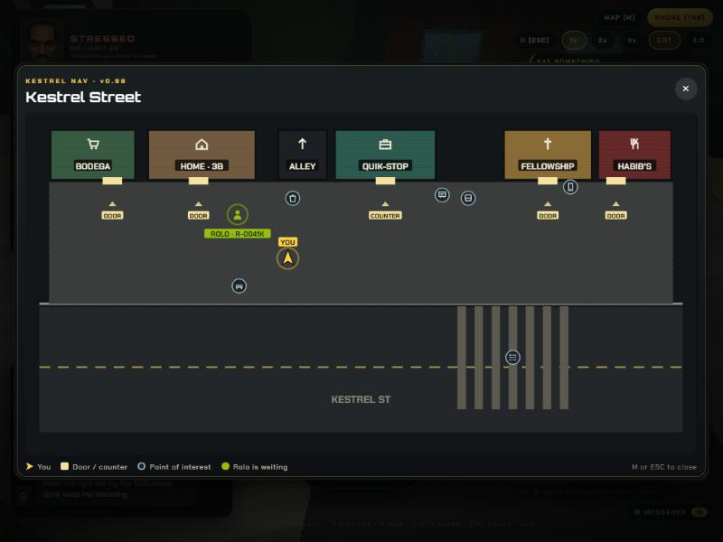
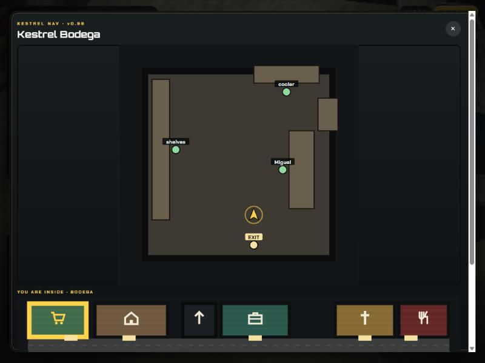

# MO: FUNCTIONAL

> *You don't have to get your life together. You just have to keep it together.*

A dark-comedy **life-management simulation** set on one block of New York City in the late
1990s, rendered like an obscure 1998 PlayStation game. Mo has a job at a corner store, a
week-to-week lease, a phone full of people who want things, and a dependence that has been
quietly rewriting his week. Rent is due on Day 7. He does not have it.

Built with Three.js and vanilla JavaScript ES modules. No backend, no build step, no install.



---

## Play it

**Live:** <https://xiondigital.net/mofunctional/> (served from `main`)

The game is a static site. ES modules don't load over `file://`, so serve the folder:

```bash
npm start
```

That runs `python3 -m http.server 8080`; `npx serve -l 8080 .` works too. Open
**http://localhost:8080** and click **PRESS START** (audio starts on that first click, per
browser autoplay rules). Saves live in `localStorage`: three slots plus an autosave.

---

## The game

**The loop.** Time runs while you play (1×, 2×, 4×) and stops while the phone, a shop board, the
map or a dialog is open. Every action costs minutes. Mo has seven needs — energy, food,
hygiene, stress, morale, dependence and overdose risk — and the week is about keeping enough of
them above water to make rent, keep the job, and not die.

**Dependence and risk.** Mo starts the game dependent. Withdrawal begins about thirteen hours
after his last dose (later as tolerance grows; on day one, mid-afternoon), raising stress and
dragging energy and morale; sleep slows it down and does not compound it. The substances (Bliss, Static, Mud, Drip) are **invented** and described only in
mechanical terms. Using one relieves withdrawal and lifts some stats, raises dependence,
tolerance and risk, and does less each time. Risk at 100 ends the run.

**Money.** The Quik-Stop shift pays hourly (late arrivals are docked; three strikes and he is
fired). The job board has odd jobs for cash today. BidBay sells his things over time; Dex in the
alley buys them for less, right now. The Civic Relief Program gives food credit if Mo has his ID
and lease. Rent ($420 every 7 days), power and phone bills come due; two missed rent cycles is
eviction.

**Eleven endings**, from *functional* and *steady* to *evicted*, *terminated*, *pledged*,
*snapped* and *overdose*. The night closes with a **Daily Report**: money, energy, hunger,
stress, dependence and risk for the day just ended.

### Places

| Place | What is there |
|---|---|
| **Unit 3B, 1120 Kestrel St.** | bed, fridge (storage), shower, TV, laptop, Chairman the cat |
| **Kestrel Street** | the block: neighbours on schedules, street events, the job board, the bus stop, the alley |
| **Quik-Stop #14** | Mo's job: clock in from the storefront counter |
| **Kestrel Bodega** | Miguel's: bacon egg and cheese, chopped cheese, loosies, tall boys |
| **Habib's Corner** | halal, no pork: chicken over rice, the combo plate, falafel, lentil soup |
| **The Golden Fellowship** | Addison Octavius, the allowance, the tithe, the pledge |

Every door on the block is built the same way so it can be found at a glance: a recessed door in
a pale frame, a step and a mat, a lamp over it with the pool of light it throws, and a lit sign.
The bodega has its own low building west of the walk-up, with a red-and-yellow sign and an OPEN
light, and Mo comes back out of whichever door he went in.

### People

Mo; **Addison Octavius**, the Fellowship's shepherd; **Rae Vell**, the landlord (he does the
rounds with a clipboard); **Dale**, the Quik-Stop manager; **Kev**, the coworker; **Miguel** and
**Habib** behind their counters; **Dex** in the alley at night; **Rolo**, on the other end of
the dealer line; and the people who live on the street. Neighbours keep daily schedules (Dale
opens the store and smokes by the board; Kev drinks on the bench at night; Dex holds the alley
after dark) and street encounters interrupt with real choices.

Every character is built the late-90s console way: lofted faceted limbs with joint caps and a
low-poly skull wearing one wrap-around face texture. Mo's face comes from his mood sheet; NPC
faces come from the owner's face bank or are painted in the same style. Mo's 3D head can blend
into expressions painted onto that texture: **high** (bloodshot eyes, heavy lids, a smirk — the
title screen) and **smile** (both corners up — a deal that went right).

---

## The MoPhone

`TAB` opens it. A rounded handset with a lock-screen clock, two widgets (Mo's mood and what is
due next), an icon grid and a dock. Every app is a parody with its own name, icon and layout:

| App | What it is |
|---|---|
| **Txtr** | messages; companies text with their app icon, people with their face; Rolo is pinned |
| **Shale Pay** | the bank: a debit card with the live balance, bills, recent activity |
| **LinkedOut** | the Quik-Stop shift, strikes, odd jobs |
| **BidBay** | list valuables at a price you set; a mystery grab bag |
| **iDread** | the week ahead (shifts, rent, power, service) and sleep |
| **GrubHope** | groceries for cash or Civic Relief credit, relief programs |
| **Pocket Lint** | inventory as illustrated tiles; eat, drink, smoke or sell from here |
| **Landlordly** | a thermostat dial that counts down the days to rent |
| **FeedLove** | a profile, followers, posting for likes |
| **Blessed+** | the Fellowship's "live" Sunday stream and the tithe |
| **Rolo's Line** | the dealer app (below) |
| **Tweaks** | skin, interface scale, camera distance and height, volume, saves, run stats |



**HUD messages** arrive as text bubbles in the bottom-right corner, fade out of the way, and are
never thrown out: hover the **MESSAGES** pill (or click it to pin it) to scroll back through the
day. Incoming texts also open as an SMS thread on the left; when a text asks something, the
thread waits for Mo's answer and files it in Txtr.

**Seven skins** — Functional, Amber, Ice, VHS, Primo, Bodega and Graphite — recolour the HUD,
phone, menus and panels from one set of CSS variables. Set them in the main menu's `SETTINGS` or
in Tweaks.

---

## Rolo: the dealer line

Rolo takes orders by text and through **Rolo's Line**, a crude WAP-era app. Both are faces on
one order system (`src/systems/dealer.js`): the same catalog, prices, validation and order.

- **By text.** Open Txtr → ROLO. Mo's replies are quick-reply chips, and Rolo's answers are
  written from the order state: the menu with prices, "how many?", the total, then the order
  ID, meet spot and time.
- **In the app.** Pick a product (each has a description, its risk and dependence), set the
  quantity (1–3), see the total against Mo's balance, and place the order. Afterwards the app
  shows the order card: ID, status (*en route* → *waiting outside* → *completed*), ETA and
  location.
- **The meet.** About 20 game minutes after the order, Rolo walks in along the curb and waits at
  the hydrant beside the 1120 stoop — clear of every door — with a **Meet Rolo** interaction on
  him. He shows on the map and the minimap. Walk up, hand over the cash, and Mo's hand goes out,
  comes back, and he smiles. Rolo walks off the block.
- **Prices** are the fictional substances' base prices plus a $4 walk fee. Payment is **cash on
  meet**.

**Integrity.** Only one order can be open at a time. Ordering checks the balance up front and
the handoff checks it again; being short at the meet cancels the order without charging. Money
moves exactly once, inside the handoff, after the order is marked completed, so a second click
or a second call finds a finished order and does nothing. The thread ignores taps while Rolo is
"typing". Orders are saved with the run: reload mid-order and he is still on his way (or
standing there); leave him waiting three game hours and the order expires, uncharged.





---

## Food, shops and the fridge

**Menu boards.** Miguel's and Habib's open an illustrated board: the owner's face and a line of
his, Mo's cash, and a card per item with its art, price tag, effect chips and the owner's note.
Click a card to buy; it stamps **BAGGED** and the board stays open.

**The fridge** in Unit 3B is storage: two shelves side by side (the fridge and Mo's pockets),
with STORE, TAKE and EAT. Anything edible can also be eaten straight from Pocket Lint.

**Eating is on screen.** Mo turns toward the camera and takes the item in three bites, with
crumbs and a munch on each; a drink is a long pull and a gulp, a loosie is a drag. Then he pauses
and the HUD bars ease up to the new values.




---

## Map and navigation

`M` opens the map (or click the minimap under the HUD panel). It is drawn from the same data the
street is built from (`src/world/plan.js`), so a door on the map is where the door is.

- **On the street:** each building as a block with its icon and name, doors and the Quik-Stop
  counter marked on the frontage, the walkable sidewalk distinct from the road, the curb and the
  crosswalk, points of interest (job board, bus stop, bench, dumpster, payphone), Mo as an arrow
  showing which way he faces, and Rolo's meet spot when there is an order.
- **Inside:** the room's actual floor plan — walls, counters, shelves and other colliders —
  every interaction, the EXIT, and Mo, with a strip of the street underneath highlighting the
  building he is in.
- **The minimap** is the same drawing at strip size, redrawn a few times a second.




---

## Soundtrack

Seven tracks in `/Music`, each written for a place, played through one crossfading director
(`src/systems/soundtrack.js`). One track is heard at a time. Moving between places crossfades
(about 1.8 s); a place that shares the current track never restarts it; a track left mid-song
resumes where it was when Mo comes back. The menu always starts from the top.

| File | Plays |
|---|---|
| `Mo Functional_ Main Menu.mp3` | title screen and menus |
| `Mo Functional_ City.mp3` | Kestrel Street by day |
| `Mo Functional_ Quik-Stop.mp3` | within a few metres of the Quik-Stop front, at its counter, and for a minute after a shift |
| `Mo Functional_ Bodega.mp3` | inside the bodega |
| `Mo Functional_ Habib.mp3` | inside Habib's Corner |
| `Mo Functional_ Church.mp3` | inside the Golden Fellowship |
| `Mo Functional_ Lost Time.mp3` | Unit 3B; the street from 22:00 to 05:00; severe withdrawal; the endings |

The files are 64 kbps, 48 kHz MP3s and are played exactly as delivered. Their low resolution,
grain and crunch are the sound of the game, and nothing in the audio chain filters or
normalises them. Sound effects (UI blips, doors, cash, munching, the mumbled NPC voices) are
synthesised live in WebAudio.

---

## Controls

Movement is camera-relative: **W always walks into the screen**.

| Input | Action |
|---|---|
| `W A S D` / arrows | Move |
| Click the floor | Walk Mo there (a drag orbits) |
| `Q` `E`, mouse drag | Orbit the camera |
| `F` / `Space` / `Enter` | Interact with whatever is near |
| `TAB` | Phone |
| `M` | Map |
| `ESC` | Pause, or close what is open |
| `1` `2` `3` | Speed 1× · 2× · 4× |
| `C` | CRT scanlines |
| `R` | 4:3 framing |

**Gamepad** (standard mapping): left stick / D-pad move, bumpers, triggers and the right stick
orbit, `A` interact, `B` phone, `START` pause, `X`/`Y` speed. The HUD has buttons for the phone,
map, pause, speed, CRT and 4:3.

---

## Rendering

Late-90s console rendering in a custom shader: a low internal resolution scaled up, affine
texture mapping, vertex snapping, ordered dithering and fog, with procedural textures painted at
low resolution and nearest-filtered. Signs and shop names are painted the same way. An optional
CRT layer adds scanlines, vignette, tracking and grain.

---

## Project layout

```
index.html              page shell, CRT overlay, UI root
styles/main.css         base UI: HUD, phone chassis, threads, menus, modals
styles/ui2.css          skins, message feed, MoPhone apps, Rolo's Line, menu boards,
                        fridge, map and minimap, daily report
Music/                  the soundtrack (see above)
src/main.js             orchestrator: loop, state flow, saves, handoff, map toggle
src/core/               config (all balance values), state, input, audio (crossfades
                        + synthesised sfx), save, util
src/systems/            needs, economy, jobs, events, street, fellowship, dialogue,
                        endings, dealer (Rolo's orders), soundtrack (music director)
src/world/              game3d (renderer, camera, movement), areas (every location),
                        plan (the street as data, shared with the map), characters,
                        schedules, shops, title (the title performance), eating,
                        handoff (Rolo on the street + Mo's smile)
src/render/             retro renderer, textures, signs, heads (skull, wrap faces,
                        expressions), faces (HUD portraits)
src/ui/                 hud, feed, phone, apps (parody catalog + icons), icons (item
                        art), shopmenu, fridge, map, threads, modal, menu, themes
scripts/check-syntax.mjs  parses every module in src/ (npm run check)
docs/                   design notes, devlog, art handoff
```

Balance lives in `src/core/config.js`. Gameplay code reads from `CONFIG` rather than
hard-coding numbers.

```bash
npm run check    # syntax-checks every module (no dependencies)
```

There is no automated gameplay test suite. Features are checked by playing the build; the
latest pass covered soundtrack switching, the dealer flow (text, app, meet, edge cases, save
and reload), entering and leaving every building, and the map against world positions.

---

## Known limitations

- The site is served with long cache lifetimes, so a player can briefly mix old and new files
  after a deploy. New code is added in new modules (or reached through optional calls) so a
  stale file degrades a feature rather than stopping the game, but a hard refresh or a cache
  purge is the clean fix.
- Unit 3B has no track of its own in `/Music`; it uses *Lost Time*, which it shares with the
  street at night.
- The talk prompts for street NPCs sit at their default spots; when a neighbour's schedule moves
  them elsewhere, the prompt stays put.
- Rolo only meets on Kestrel Street. Ordering from inside a building works; he waits outside.

---

## Notes

- Everything here is fiction. The substances (Bliss, Static, Mud, Drip) are invented and
  described only in mechanical terms — no real-world dosing, sourcing or preparation detail.
- Kestrel Street, the Golden Fellowship, Addison Octavius, Rolo, Quik-Stop, Shale Mobile, the
  Civic Relief Program and the phone apps (Txtr, Shale Pay, LinkedOut, BidBay, iDread, GrubHope,
  Pocket Lint, Landlordly, FeedLove, Blessed+, Rolo's Line, Tweaks) are original fiction or
  parody; no real app's logo or trademark is used.
- The visual style is an homage to late-90s console rendering. No platform assets are used.
