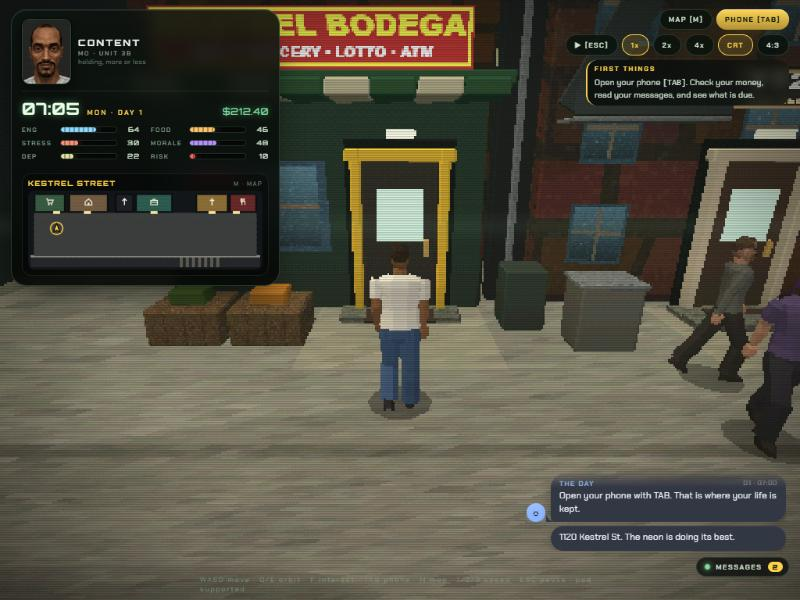
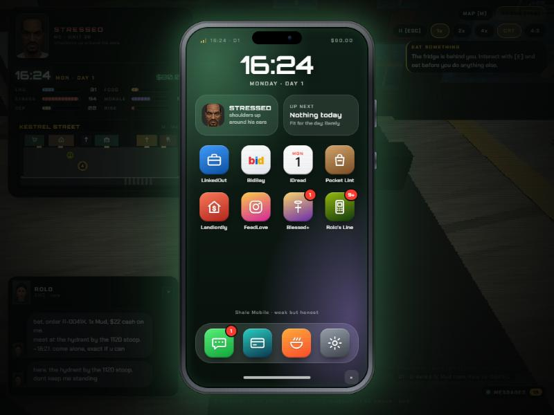
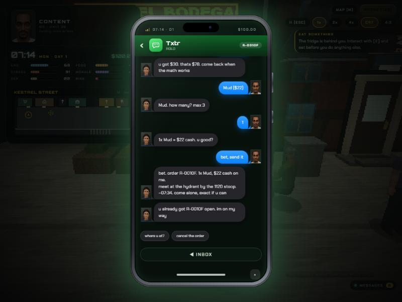
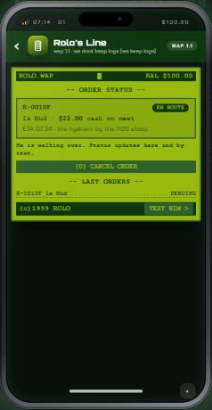
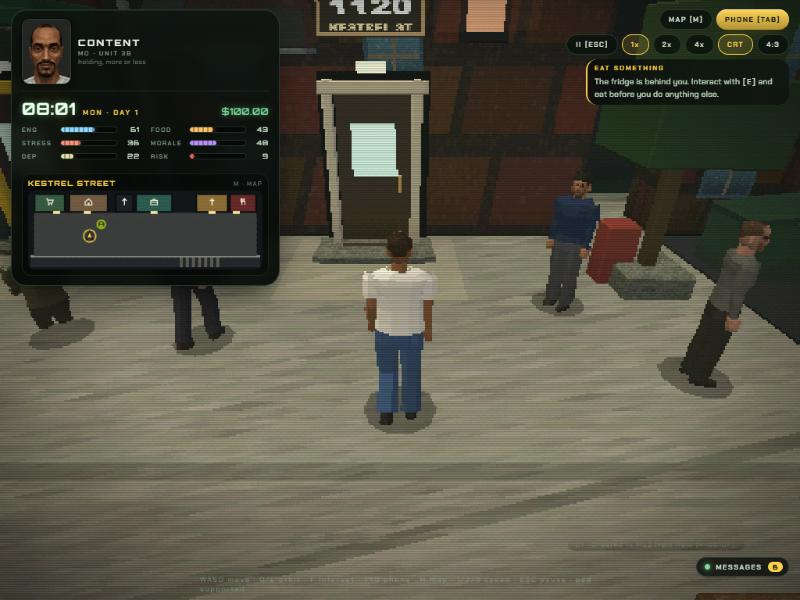
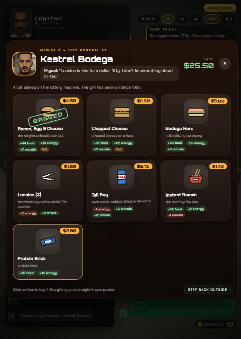
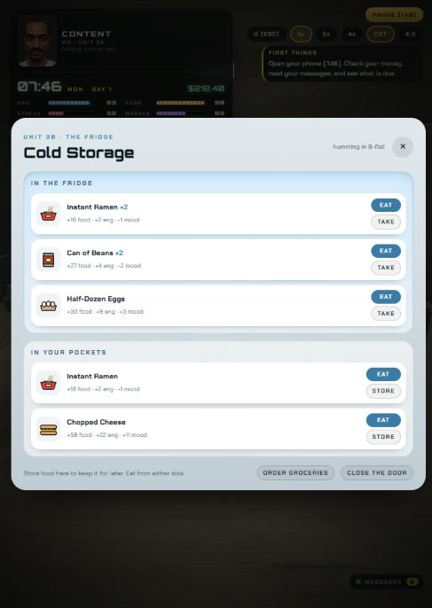
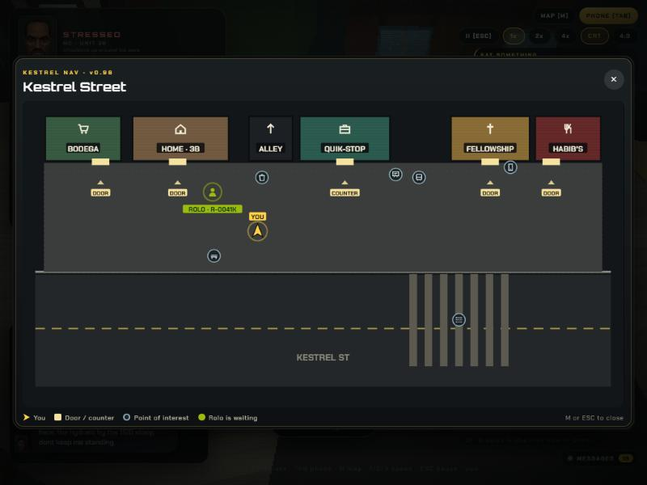
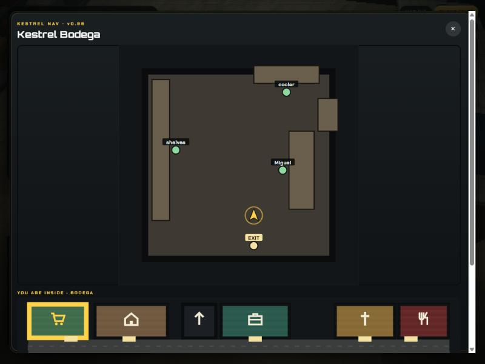

# MO: FUNCTIONAL

> *You don't have to get your life together. You just have to keep it together.*

A dark-comedy **life-management simulation** set on one block of New York City in the late
1990s, rendered like an obscure 1998 PlayStation game. Mo has a job at a corner store, a
week-to-week lease, a phone full of people who want things, and a dependence that has been
quietly rewriting his week. Rent is due on Day 7. He does not have it.

Developed by **XiØN** (xiondigital). Inspired by 90s-era console games, life in New York, and
the circumstances that people in the inner city know all too well. Built with Three.js and
vanilla JavaScript ES modules. No backend, no build step, no install.



---

## Play it

**Live:** <https://xiondigital.net/mofunctional/> (served from `main`)

The game is a static site. ES modules don't load over `file://`, so serve the folder:

```bash
npm start
```

That runs `python3 -m http.server 8080`; `npx serve -l 8080 .` works too. Open
**http://localhost:8080** and click **PRESS START** (audio starts on that first click, per
browser autoplay rules). Saves live in `localStorage`: three slots plus an autosave.

---

## The game

**The loop.** Time runs while you play (1×, 2×, 4×) and stops while the phone, a shop board, the
map or a dialog is open. Every action costs minutes. Mo has seven needs — energy, food,
hygiene, stress, morale, dependence and overdose risk — and the week is about keeping enough of
them above water to make rent, keep the job, and not die.

**Dependence and risk.** Mo starts the game dependent. Withdrawal begins about thirteen hours
after his last dose (later as tolerance grows; on day one, mid-afternoon), raising stress and
dragging energy and morale; sleep slows it down and does not compound it. The substances (Bliss, Static, Mud, Drip) are **invented** and described only in
mechanical terms. Using one relieves withdrawal and lifts some stats, raises dependence,
tolerance and risk, and does less each time. Risk at the ceiling is an overdose: the ER, not an
ending.

**Two dealers.** Rolo (by phone, any time) sells the ordinary, cut versions. **Dex** is in the
alley only after dark, 18:00–04:00 — by day he is not on the block at all — and he sells what
Rolo does not: *uncut* Bliss, double-stacked Static, Black Mud and pure Drip. More effect for the
money, much more risk and dependence, and roughly one batch in seven is wrong, which spikes risk
and stress on top of the dose.

**Money.** The Quik-Stop shift pays hourly (late arrivals are docked; three strikes and he is
fired). The job board has odd jobs for cash today. BidBay sells his things over time; Dex in the
alley buys them for less, right now. The Civic Relief Program gives food credit if Mo has his ID
and lease. Rent ($420 every 7 days), power and phone bills come due; two missed rent cycles is
eviction.

**Rent can be paid early.** If nothing is outstanding, the Banking app's rent card and
Landlordly both offer **PAY EARLY**: it settles the *next* cycle in advance, moves the due date
on by a week, and the due date finds the cycle already settled, so Mo is never charged twice.
One cycle ahead at most, and a short lock swallows a double click. Every payment is recorded in
`bills.rent.history` (day, amount, which cycle, the partner share that applied) and shown in the
app.

**No game over.** Nothing ends the run on its own except one thing: being saved by the
Fellowship (below). Otherwise the run ends when the player chooses to close the book, and the
epilogue fits where Mo's life stands then. The night closes with a **Daily Report**: money, energy, hunger,
stress, dependence and risk for the day just ended.

### Places

| Place | What is there |
|---|---|
| **Unit 3B, 1120 Kestrel St.** | bed, fridge (storage), shower, TV, laptop, Chairman the cat |
| **Kestrel Street** | the block: neighbours on schedules, street events, the job board, the bus stop, the alley |
| **Quik-Stop #14** | a real convenience store, open all night: two aisles, coolers, coffee, the register, customers; the time clock is behind the EMPLOYEES ONLY door |
| **Kestrel Bodega** | Miguel's: bacon egg and cheese, chopped cheese, loosies, tall boys |
| **Habib's Corner** | halal, no pork: chicken over rice, the combo plate, falafel, lentil soup |
| **The Golden Fellowship** | Addison Octavius, the allowance, the tithe, the pledge — the one ending that takes the game away |
| **Kestrel Clinic** | walk-ins, Nurse Okafor, treatment on cash or on the bill |
| **Kestrel Park** | across the road (Mo walks over the crosswalk by the Fellowship, or the one by the lot to the east gate): benches, a half-court, chess, a boombox, people |
| **1104 Kestrel St.** | the walk-up west of the bodega: a lobby and four floors of hallway, real minutes on the stairs. A man asleep by the steps, Ray & Denise arguing on two, Mrs. Petrakis's soup in 3B, Squeak selling from his coat on four (a few items a day, hallway prices), Stephanie's door in 5C, the roof, and a knock on every door |
| **Ashby Avenue** | by the B44 from the stop on Kestrel (or a 45-minute walk): people walking somewhere else, a newsstand (papers, scratch-offs), Ashby Pawn & Gold (sell a valuable now, cheap), a sax player |
| **The road** | walkable now: cars parked along both curbs (new low-poly models — 90s compact, sedan, taxi, sports coupe, convertible, exotic GT, and the B44 bus — in street colours), and traffic in both lanes that keeps its distance, stops for Mo when he is in the road, leans on the horn, and drives on. Cars are solid. At night, the cars on the near curb can be tried: mostly locked, sometimes loose change, food, cigarettes or something worth selling, sometimes the alarm |
| **Street life** | people walking to somewhere else (they wait for Mo instead of walking through him), smokers outside the Quik-Stop and the bodega with smoke you can see, somebody on the bench, a dice crew crouched over crates at the lot after dark, and things that happen where Mo can see them: a patrol car rolling by with its lights going, a kid on a bike, a split grocery bag |
| **Dee's Wash & Fold** | the laundromat on Ashby: washers down one wall, dryers stacked down the other, a folding table, two vending machines (soda, water, tall boys, chips — one of them sometimes eats a dollar), a TV nobody chose, mothers folding, kids running the aisle. Do a load ($3, 45 minutes, clean clothes), check the machines for change once a day (quarters, a sock, now and then something somebody will miss). Buy it on TradeHarder ($60,000): a weekly take smaller than 1104's, upkeep, a machine that dies now and then, and the back room — a computer that does everything the laptop does, and the books, where cash is washed into a property's renovations (each level +15% to its weekly take; the machines keep 8%; now and then the city reads the books) |
| **The 84th Precinct** | on Ashby Avenue (green lamps, cops on the steps): inside, a desk sergeant, cops at their desks, one walking through, one taking a statement, and at the back, inmates in orange on the wall phones behind the glass with their visitors. Some nights two cops walk the park: a mugging in their sight ends before it starts, and a cop who sees Mo high searches him. Clean, he is told to go home; holding, every substance is confiscated, he is fined $250 (or whatever he has), spends the night in holding and walks out onto Ashby in the morning |
| **The payphone** | outside the Fellowship: the coin return and the gap behind the box (change, now and then somebody's stash), and late at night it sometimes rings: Dex, with something taped behind the box for cash in the slot |
| **Meatball** | a stray dog who walks the block. Feed him (two meals a day) and he likes Mo more; past halfway he trots along beside him; at full, Mo can whistle for him when somebody tries to mug him on the street or in the park |
| **Night** | a man in the alley corner facing the wall, and on the third floor of 1104 two people by the stairs who could not wait for an apartment (a mosaic covers it; "This isn't my business") |
| **The lot** | past the clinic: chain-link, a burnt-out Buick, a graffiti wall, a dice game after dark, and a crosswalk to the park's new east gate |
| **Lucia's** | a red-sauce trattoria on Ashby: sit-down meals, and the best date on the list |

Every door on the block is built the same way so it can be found at a glance: a recessed door in
a pale frame, a step and a mat, a lamp over it with the pool of light it throws, and a lit sign.
The bodega has its own low building west of the walk-up, with a red-and-yellow sign and an OPEN
light, and Mo comes back out of whichever door he went in.

### People

Mo; **Addison Octavius**, the Fellowship's shepherd; **Rae Vell**, the landlord (he does the
rounds with a clipboard); **Dale**, the Quik-Stop manager; **Kev**, the coworker; **Miguel** and
**Habib** behind their counters; **Dex** in the alley at night; **Rolo**, on the other end of
the dealer line; and the people who live on the street. Neighbours keep daily schedules (Dale
opens the store and smokes by the board; Kev drinks on the bench at night; Dex holds the alley
after dark) and street encounters interrupt with real choices.

Three of the people on the block can be dated — **Stephanie**, **Melanie** and **Diana** — and a
small heart over their heads is the only thing that marks them out. Everyone else has no heart,
and no interest.

Every character is built the late-90s console way: lofted faceted limbs with joint caps and a
low-poly skull wearing one wrap-around face texture. Mo's face comes from his mood sheet; NPC
faces come from the owner's face bank or are painted in the same style. Mo's 3D head can blend
into expressions painted onto that texture: **high** (bloodshot eyes, heavy lids, a smirk — the
title screen) and **smile** (both corners up — a deal that went right).

---

## The MoPhone

`TAB` opens it. A rounded handset with a lock-screen clock, two widgets (Mo's mood and what is
due next), an icon grid and a dock. Every app is a parody with its own name, icon and layout:

| App | What it is |
|---|---|
| **Txtr** | messages; companies text with their app icon, people with their face; Rolo is pinned |
| **Shale Pay** | the bank: a debit card with the live balance, bills, recent activity, and an **AutoPay** toggle that pays rent, power and phone the day they fall due if the balance covers them (a Shale Pay text for every payment, and an insufficient-funds text when it does not) |
| **LinkedOut** | the Quik-Stop shift, strikes, odd jobs |
| **BidBay** | list valuables at a price you set; a mystery grab bag |
| **iDread** | the week ahead (shifts, rent, power, service) and sleep |
| **GrubHope** | groceries for cash or Civic Relief credit, relief programs |
| **Pocket Lint** | inventory as illustrated tiles; eat, drink, smoke or sell from here |
| **Landlordly** | a thermostat dial that counts down the days to rent |
| **FeedLove** | the social app (a heart, not a camera), in four tabs: **FEED** (Mo's profile, a box to type his own posts or a random one, and a timeline of everyone he follows — Mom, Nia, Kev, Dale, Rae, Miguel's bodega and its cat, Habib's, the Fellowship, the Quik-Stop, the park, and the three once he has met them — with pictures and likes), **PEOPLE** (following, followers, people you may know), **♥ HEARTS** (the dating side) and **LOVELINE** (the three, where they are, and her day) |
| **LonelyFans** | the subscription app, locked until it is paid for: $2 a day (and AutoPay can carry it), four invented models whose pictures lower stress and morale, a dignity gate that refuses a man at the bottom of the barrel, and the occasional $500 offer that is still, deliberately, not explicit |
| **HailMary** | the car service ("a ride and a prayer"): call a black car, it pulls up at the curb out front a few minutes later, walk up and get in, pick a destination. Ask for somewhere on the same block and the driver will not start the car ("It's up the road, idiot. Just walk.") and keeps a stop fee; across town is a real ride, and a no-show is charged |
| **TradeHarder** | stocks (nine 1999 tickers on a daily seeded walk: dot-coms, a bank, the Fellowship's media arm, a Y2K survival company) and property: 1104 Kestrel ($100,000, eight units of weekly rent, tenants who fall behind, move out, or offer to pay in product) and the lot ($30,000) |
| **Amazin'** | buy things (electronics, gifts, comforts, food that keeps) at retail; delivered by the door next morning |
| **HardLuck Bet** | an online casino: slots, blackjack and roulette for real money. The odds are honest (slots return about 93%), the first $10 bet is free, a losing day stings, and winnings are tithed like any other income |
| **NextStoop** | the neighbourhood app: **SEEN NOW** (neighbours posting who is where, from the real schedules — useful for finding people), **THE BOARD** (a day of lost-and-found, safety, free stuff and complaints) and **HISTORY** (the lore of Kestrel Street, a page a day) |
| **Blessed+** | the Fellowship's "live" Sunday stream and the tithe |
| **Rolo's Line** | the dealer app (below) |
| **Tweaks** | skin, interface scale, camera distance and height, volume, saves, run stats |



**HUD messages** arrive as text bubbles in the bottom-right corner, fade out of the way, and are
never thrown out: hover the **MESSAGES** pill (or click it to pin it) to scroll back through the
day. Incoming texts also open as an SMS thread on the left; when a text asks something, the
thread waits for Mo's answer and files it in Txtr.

**Seven skins** — Functional, Amber, Ice, VHS, Primo, Bodega and Graphite — recolour the HUD,
phone, menus and panels from one set of CSS variables. Set them in the main menu's `SETTINGS` or
in Tweaks.

---

## Rolo: the dealer line

Rolo takes orders by text and through **Rolo's Line**, a crude WAP-era app. Both are faces on
one order system (`src/systems/dealer.js`): the same catalog, prices, validation and order.

- **By text.** Open Txtr → ROLO. Mo's replies are quick-reply chips, and Rolo's answers are
  written from the order state: the menu with prices, "how many?", the total, then the order
  ID, meet spot and time.
- **In the app.** Pick a product (each has a description, its risk and dependence), set the
  quantity (1–3), see the total against Mo's balance, and place the order. Afterwards the app
  shows the order card: ID, status (*en route* → *waiting outside* → *completed*), ETA and
  location.
- **The meet.** About 20 game minutes after the order he is due. He does not appear out of thin
  air behind the camera: if Mo is standing on the street when Rolo gets close, Rolo texts him to
  go in somewhere (a coffee at the Quik-Stop, the bodega, home) and he is at the hydrant beside
  the 1120 stoop when Mo comes back out. If Mo was already inside, Rolo is simply there when he
  steps out. Rolo then waits three game hours — counted from when he is actually standing there —
  with a **Meet Rolo** interaction on him, on the map and the minimap. Walk up, hand over the
  cash, and Mo's hand goes out, comes back, and he smiles. Rolo walks off the block.
- **Prices** are the fictional substances' base prices plus a $4 walk fee. Payment is **cash on
  meet**.

**Integrity.** Only one order can be open at a time. Ordering checks the balance up front and
the handoff checks it again; being short at the meet cancels the order without charging. Money
moves exactly once, inside the handoff, after the order is marked completed, so a second click
or a second call finds a finished order and does nothing. The thread ignores taps while Rolo is
"typing". Orders are saved with the run: reload mid-order and he is still on his way (or
standing there); leave him waiting three game hours and the order expires, uncharged.





---

## Food, shops and the fridge

**Menu boards.** Miguel's and Habib's open an illustrated board: the owner's face and a line of
his, Mo's cash, and a card per item with its art, price tag, effect chips and the owner's note.
Click a card to buy; it stamps **BAGGED** and the board stays open.

**The fridge** in Unit 3B is storage: two shelves side by side (the fridge and Mo's pockets),
with STORE, TAKE and EAT. Anything edible can also be eaten straight from Pocket Lint.

**Eating is on screen.** Mo turns toward the camera and takes the item in three bites, with
crumbs and a munch on each; a drink is a long pull and a gulp, a loosie is a drag. Then he pauses
and the HUD bars ease up to the new values.




---

## The clinic

**Kestrel Clinic** is at the east end of the block, past Habib's: pale tile, a red cross, a ramp
and a sign that says WALK-INS · NO APPOINTMENT NEEDED. The door is on the street like every other
door. Inside there is a plastic chair, a scale nobody stands on, and **Nurse Okafor**.

- **Treatment** is $60 and 90 minutes: risk and withdrawal come down, dependence comes down a
  little. If Mo cannot pay, it goes on the **hospital bill** — the clinic does not turn anyone
  away, it keeps a record instead.
- **Checking in** is free and takes ten minutes; it slows withdrawal.
- **The waiting chair** costs 20 minutes and calms him down.
- One treatment a day. She will not do it twice, and she says so.
- **The outpatient course** is the slow way down. Sign up at the counter (it takes a referral —
  the ER card, the paramedics' napkin — or a real habit). Five sessions, every other day, kept in
  person between 10:00 and 16:00, two hours and $35 each (on the bill if he is broke). Every
  session lowers dependence, withdrawal and risk; finishing the course takes dependence and
  tolerance down further and counts as a milestone. Clinic hours overlap Quik-Stop shifts, so the
  course competes with work. One missed appointment is forgiven with a text from Okafor; a second
  drops him, and she will take him back three days later. Using during the course does not get
  him thrown out — it makes the next session count for half. The course shows in the clinic app
  and on the iDread calendar.

**Collapse.** When Mo goes down — energy at zero, an overdose that does not end the run, too long
awake — he falls, the screen fades to black, hours pass, and he wakes beside his own bed or here.
After two collapses in a run they start taking him in; before that it is a coin toss, and it is not
a coin toss at all if he has no home. He loses the hours, the shift, some money, and he wakes up
in the state that put him there, not refreshed. A collapse locks further collapses out for five
hours, so it cannot become a loop.

## Kestrel Park

The crosswalk (or the gate interaction on the sidewalk) leads across the road to **Kestrel Park**:
grass, a path, three benches facing each other so people can talk, a half-court with a bent rim, a
chess table with a bottle cap for a missing knight, a playground nobody maintains, a boombox on a
crate, and a few people who are simply there. It is drawn on the map and the minimap from the same
data the park is built from.

| Interaction | What it does |
|---|---|
| **Sit on the bench** | 30 min · morale up, stress down |
| **Shoot around** | 45 min · the best free morale on the block |
| **Play chess** | 40 min · against whoever is sitting there; you can win |
| **The boombox** | 20 min listening — or **dance**, 25 min, morale up and stress down |
| **Talk to Kev** | he is losing at chess to himself |

Dancing is a real performance on the world stage (`playDance`), not a menu line: Mo moves on the
spot, the time passes and the stats move with it.

## The Golden Fellowship

Addison Octavius is the antagonist, but not a villain in the usual sense: he extorts Mo for
money. From the tithing stage he takes a tenth of everything Mo earns, and a fifth once Mo is in
the inner circle. The terrible part is that it works. Every service from "Attendee" on brings
dependence and withdrawal down, and once Mo tithes, the routine itself (the calls, the rides,
somebody asking where he was) eases withdrawal every day. The deeper he goes, the cleaner he gets
and the more of his money and his say they take.

Signing the pledge ends the game: **Fully Functional**. Mo stops using, is housed, employed and
more than functional — and none of it is his. It is the ending where someone else saved him, which
is not what this game is about. Walking out instead keeps the run going.

## The laptop

The laptop on the table in Unit 3B opens a laptop screen the way the phone opens (the same apps
run on both): Netscrape Navigator and its bookmarks — FeedLove, NextStoop, LinkedOut, TradeHarder,
Amazin', HardLuck Bet, BidBay, **MeTube** (videos and memes from 1999; a time sink with a little
morale in it), **Kestrel Underground** (an anonymous message board: rumours about the Fellowship,
Dex, the 1996 night at Quik-Stop #14, Gus, the walk-up; Mo can post into any thread) and
**DialUpDelights** (an adult site where every model is a mosaic and each page takes six minutes on
dial-up; a little better, once or twice a day).

## After dark

Late at night in the park, at the alley and walk-up end of the block, past the clinic, or on
Ashby, somebody in a grey hood may step out and want his wallet. Hand over a quarter of his cash,
run (energy decides), or fight: a swing meter, F or Space in the green lands, three that land and
he runs. Every miss is a hit back. At zero energy Mo goes down, is robbed (cash and a few things,
food first) and wakes up at the clinic.

## The clap

A night with one of the open FeedLove women can leave something behind. It shows up the next day
and drains energy and morale by the hour until Mo pays for antibiotics at Kestrel Clinic (or puts
them on the hospital bill). Once it shows, he can text her "You gave me the clap" (she is gone
after that), or post a warning about her on NextStoop — which the block may applaud, or which she
may answer, and the block takes her side.

## Nia

Mo's sister texts and calls. How he answers is the bond between them: talking properly or being
honest raises it, brushing her off lowers it. Once it is good enough, every few days she asks if
she can come over. Say yes and she walks into Unit 3B the next evening (18:00-21:00) with a bag of
food: sitting down to eat with her is the best meal in the game (a big chunk of energy and food,
morale, less stress). Miss her and the food is left on the radiator with a text; say no and the
bond takes a hit.

## Love on Kestrel Street

Three adults can be dated: **Stephanie** (31, relaxed, low-maintenance), **Melanie** (34, warm and
particular) and **Diana** (36, independent and exacting). They are approachable when the heart is
over their head — the heart means *you could try*, not *she is interested*.

**How they look.** Their faces, hair and clothes come from the owner's sheet
(`assets/ref/partner_face_bank.png`): Diana with straight brown hair to the shoulders and a grey tee,
Stephanie with long, messy black hair and a black zip hoodie, Melanie with a mass of black curls
and a black tank top. The faces are baked into portraits and 3D head textures by
`scripts/bake-npc-faces.py`; the hair below the jaw is real geometry.

**Where they are.** Each of them has her own day, all over the block (`world/schedules.js`):

| | Morning | Afternoon | Evening |
| --- | --- | --- | --- |
| **Diana** | park 07:00, Quik-Stop coffee 08:30 | work in Park Slope | bus stop, Kestrel St. 17:00-19:00 |
| **Melanie** | Miguel's bodega 07:00-08:00 | teaching, then the park 15:00-18:00 | Habib's 18:00-20:00, Kestrel St. 20:00-21:00 |
| **Stephanie** | asleep until 11 | the park 11:00-14:00, Quik-Stop 14:00-16:00 | the 1120 stoop, Habib's 19:00-21:00, the bench until 01:00 |

She walks in through the door when her time comes and out again when it is over. FeedLove's LOVELINE
tab shows where each one is right now and her usual day, and NextStoop's SEEN NOW tab gossips
about it. A live-in girlfriend is at home when her day has
her off the map.

**Up close.** Once she likes him enough (or is his girlfriend), her menu adds **Hug her**, **Lean
in** (she kisses his cheek) and **Take her hand** — they walk around together, hand in hand,
until he lets go, leaves, starts something else, or her day takes her somewhere. The first of each
in a day is worth affection, morale and a little less stress; after that it is just nice.

**FeedLove HEARTS.** The social app has a dating side: open FeedLove and tap **♥ HEARTS · DATING** at the top, or the **Find someone** banner at the top of the LOVELINE tab.

**Following her.** Once Mo has met one of the three she shows up under PEOPLE. Follow her and she
follows back when she likes him enough (a girlfriend always does); her posts — her runs, her
grading, her bench, and once she is his girlfriend, him — come into the feed. Liking her post is a
little affection, once a day. When Mo posts, the people who follow him may like it, and her like
is worth a little morale. Every morning it deals a fresh stack of
profiles — strangers from around the boroughs, and, until he has matched with them, Stephanie,
Melanie and Diana. Sending a heart takes a few minutes and there are ten a day. Strangers almost
always say no (unmatched before the heart finishes animating; "do you have a car?"; left on read
at 1:14 AM); the rare match ghosts him.

**The other twenty.** The strangers are a fixed cast of twenty women (`core/strangers.js`), with
faces, hair and clothes from the owner's app sheet (`assets/ref/app_women_bank.png`), so the same
faces come round again. None of them can be dated. Most say no. A few are not looking for a
boyfriend but might be looking for company: a heart can come back as **MATCH · not for dating**,
and she goes under *Not for dating* in HEARTS with a **HOOK UP** button — after 22:00, once every
few days with each of them, not when Mo is exhausted. It is a fade to black and the long train
home: morale up, stress down, energy and hygiene down. Sometimes she flakes and is gone. If Mo has
a girlfriend, somebody might see him leave, and she will hear about it.

**Running into them.** Three of the twenty are out on the block each day (the street, the park,
the Quik-Stop, the bodega, Habib's) for an hour and a half. Until he has seen her in the app she
is just "the woman"; she may remember turning him down, or matching, and one of the open ones may
give him her number on the spot. The three answer: they match, send their number, appear
in Txtr as contacts, and from the app he can text them or ask them out through the same date
planner as everywhere else.

**Meeting them.** Talk, chat, compliment, flirt. Flirting has a cooldown and a personality-shaped
chance: Stephanie warms quickly, Melanie notices whether Mo tried, Diana does not accept a first
draft. A refusal is real, and repeated refusals cost affection.

**Dates.** Five, at real places, for real money: coffee at the bodega ($6), dinner at Habib's
($28), an afternoon in the park (free), a walk down Kestrel Street (free), a movie at home ($4).
Each takes the evening and moves Mo there. The outcome — great, good, ok, bad — is scored from her
likes and dislikes, Mo's hygiene, energy, morale and stress, his withdrawal, his balance, how
recently he took her out, her difficulty and her affection, plus a roll. A bad date ends early,
costs affection, and **the money does not come back**. The prose for each outcome is written once,
in `romance.js`, so the phone, the park and the apartment say the same thing.

**Cheeks.** After a good date — or at home later — she may come back to Unit 3B. The door closes,
the screen fades, and the game moves to the next morning. Nothing explicit is shown; the game has
never shown that and does not start now. A night that goes well grants the **Afterglow**: 24
in-game hours with morale pinned at maximum, stress down, and energy, food and hygiene at least
decent. It is a clock stamp, so it lasts exactly 24 in-game hours, is announced when it ends, and
cannot be stacked.

**Girlfriend.** Three *successful* dates (failed ones do not count) and enough affection, and Mo
can ask. She may say not yet, and she means it. Once she says yes she texts him, and keeps
texting: how the day is going, when she can see him, encouragement when he is struggling.

**Moving in.** After about a week together, with the affection to match, Mo can ask her to move
in. She becomes a resident of Unit 3B — visible, walking around, sitting down, talking, with her
own lines — and she stays put across saves and day rollovers.

| | Rent share | In the flat |
|---|---:|---|
| **Stephanie** | 15% | eats about two of Mo's things a day; not much else |
| **Melanie** | 25% | eats one; leaves small useful presents |
| **Diana** | 50% | restocks the fridge, gifts often, sells her own things |

The share is read inside `economy.rentPerCycle()` from `CONFIG.partners[id].rentShare`, for the
single live-in partner: one place, applied once, never stacked, never above half. Early payments
use the same number, so paying ahead while she lives there charges the reduced amount, and the
household menu shows her share and her habits (Mo can ask her to cover more; she will not love
it).

**Gifts.** A girlfriend sometimes texts that she left something. A parcel appears on the counter
in Unit 3B — one pending at a time, a three-day cooldown per partner — and opening it adds the
item to Mo's pockets exactly once. The pool is hers: mixtapes and chocolates from Stephanie,
useful things from Melanie, and things Diana wrapped properly.

## Map and navigation

`M` opens the map (or click the minimap under the HUD panel). It is drawn from the same data the
street is built from (`src/world/plan.js`), so a door on the map is where the door is.

- **On the street:** each building as a block with its icon and name, doors and the Quik-Stop
  counter marked on the frontage, the walkable sidewalk distinct from the road, the curb and the
  crosswalk, points of interest (job board, bus stop, bench, dumpster, payphone), Mo as an arrow
  showing which way he faces, and Rolo's meet spot when there is an order.
- **Inside:** the room's actual floor plan — walls, counters, shelves and other colliders —
  every interaction, the EXIT, and Mo, with a strip of the street underneath highlighting the
  building he is in.
- **The minimap** is the same drawing at strip size, redrawn a few times a second.




---

## Soundtrack

Seven tracks in `/Music`, each written for a place, played through one crossfading director
(`src/systems/soundtrack.js`). One track is heard at a time. Moving between places crossfades
(about 1.8 s); a place that shares the current track never restarts it; a track left mid-song
resumes where it was when Mo comes back. The menu always starts from the top.

| File | Plays |
|---|---|
| `Mo Functional_ Main Menu.mp3` | title screen and menus |
| `Mo Functional_ City.mp3` | Kestrel Street by day |
| `Mo Functional_ Quik-Stop.mp3` | inside the store, within a few metres of its front, and for a minute after a shift |
| `Mo Functional_ Bodega.mp3` | inside the bodega |
| `Mo Functional_ Habib.mp3` | inside Habib's Corner |
| `Mo Functional_ Church.mp3` | inside the Golden Fellowship |
| `Mo Functional_ Lost Time.mp3` | Unit 3B; the clinic; the street and park from 22:00 to 05:00; severe withdrawal; the endings |

Kestrel Park plays *City* by day.

The files are 64 kbps, 48 kHz MP3s and are played exactly as delivered. Their low resolution,
grain and crunch are the sound of the game, and nothing in the audio chain filters or
normalises them. Sound effects (UI blips, doors, cash, munching, the mumbled NPC voices) are
synthesised live in WebAudio.

---

## Controls

Movement is camera-relative: **W always walks into the screen**.

| Input | Action |
|---|---|
| `W A S D` / arrows | Move |
| Click the floor | Walk Mo there (a drag orbits) |
| `Q` `E`, mouse drag | Orbit the camera |
| `F` / `Space` / `Enter` | Interact with whatever is near |
| `TAB` | Phone |
| `M` | Map |
| `ESC` | Pause, or close what is open |
| `1` `2` `3` | Speed 1× · 2× · 4× |
| `C` | CRT scanlines |
| `R` | 4:3 framing |
| `~` | the hidden debug prompt (below) |

**Gamepad** (standard mapping): left stick / D-pad move, bumpers, triggers and the right stick
orbit, `A` interact, `B` phone, `START` pause, `X`/`Y` speed. The HUD has buttons for the phone,
map, pause, speed, CRT and 4:3.

---

## The debug menu

Press **`~`**, type `Moses`, press Enter. A wrong password closes the prompt with no message, no
error and no hint that anything exists. The panel is a dark green console in the game's own
style, and the clock stops while it is open:

- **Condition** — fill everything, move any single need by ±10, clear intoxication, tolerance and
  withdrawal, or reset dependence and risk.
- **Money** — $1,000 a click, as many times as you like, straight into the balance.
- **Time** — set the hour, skip hours, advance a whole day, jump to a later day (forward only:
  the bills, the life history and every cooldown are keyed to the day), pause or resume the clock.
- **World** — teleport to any area, fire any event by id, clear every event cooldown, spawn or
  despawn a chosen NPC near Mo, and reset NPC schedules (everyone snaps back to where they should
  be at this minute).
- **Relationships** — affection ±10 for each of the three, girlfriend and live-in flags, a
  pending present, or a full relationship reset.
- **Testing** — a collapse, a clinic recovery, an early rent payment, rent marked paid, a date,
  Cheeks, the Afterglow, the dance, using a substance, a free item, the phone, the daily report.

Every button calls the real system — `rent.payRent`, `clinic.treat`, `romance.startDate`,
`world.playDance`, `useSubstance` — so what it changes is what a player would get, and it all
lands in the normal save state.

## Rendering

Late-90s console rendering in a custom shader: a low internal resolution scaled up, affine
texture mapping, vertex snapping, ordered dithering and fog, with procedural textures painted at
low resolution and nearest-filtered. Signs and shop names are painted the same way. An optional
CRT layer adds scanlines, vignette, tracking and grain.

---

## Project layout

```
index.html              page shell, CRT overlay, UI root
styles/main.css         base UI: HUD, phone chassis, threads, menus, modals
styles/ui2.css          skins, message feed, MoPhone apps, Rolo's Line, menu boards,
                        fridge, map and minimap, daily report
Music/                  the soundtrack (see above)
src/main.js             orchestrator: loop, state flow, saves, handoff, map toggle
src/core/               config (all balance values), state, input, audio (crossfades
                        + synthesised sfx), save, util
src/systems/            needs, economy, jobs, events, street, fellowship, dialogue,
                        endings, dealer (Rolo's orders), soundtrack (music director),
                        rent (early pay + history), romance (partners, dates, gifts,
                        household), clinic (treatment + recovery), sms (sender
                        identity and replies), scheduler (weights, cooldowns)
src/world/              game3d (renderer, camera, movement), areas (every location),
                        plan (the street as data, shared with the map), characters,
                        schedules, shops, title (the title performance), eating,
                        handoff (Rolo on the street + Mo's smile), animations
                        (substance use, collapse, dancing)
src/render/             retro renderer, textures, signs, heads (skull, wrap faces,
                        expressions), faces (HUD portraits)
src/ui/                 hud, feed, phone, apps (parody catalog + icons), icons (item
                        art), shopmenu, fridge, map, threads, modal, menu, themes,
                        debug (the hidden menu)
scripts/check-syntax.mjs  parses every module in src/ (npm run check)
scripts/test-systems.mjs  headless system checks (npm test)
scripts/stamp.mjs         cache-busting import map in index.html (npm run stamp)
docs/                   design notes, devlog, art handoff
```

Balance lives in `src/core/config.js`. Gameplay code reads from `CONFIG` rather than
hard-coding numbers.

```bash
npm run stamp    # after changing any JS/CSS: re-stamps index.html so players get the new files
npm run check    # syntax-checks every module and fails if index.html is not stamped
npm test         # headless checks for the systems (no dependencies)
```

`npm test` runs `scripts/test-systems.mjs` in plain Node against a small game stub: rent
arithmetic, early payment and the double-payment guards, partner rent shares, date costs and
outcomes, the Afterglow clock, gifts, household restocking, event cooldowns and the daily cap,
SMS identities and replies, and clinic treatment and billing. Everything that needs eyes — the
animations, the world, the interfaces — is still checked by playing the build; the latest pass
covered soundtrack switching, the dealer flow (text, app, meet, edge cases, save and reload),
entering and leaving every building, and the map against world positions.

---

## Saves

Saves carry a version. Loading runs `src/systems/migrate.js` first: a v2 save is brought up to
v3 by letting each system build its own state block with its defaults (life, Rolo's orders,
romance, the event scheduler, the clinic and its course, rent history), so old saves keep
working. Every load also clears in-flight locks — a payment, a dose or a fall that was mid-way
when the game saved — so a reload can never leave Mo frozen.

## Known limitations

- The site is served with long cache lifetimes, so a player can briefly mix old and new files
  after a deploy. New code is added in new modules (or reached through optional calls) so a
  stale file degrades a feature rather than stopping the game, but a hard refresh or a cache
  purge is the clean fix.
- Unit 3B has no track of its own in `/Music`; it uses *Lost Time*, which it shares with the
  street at night.
- Rolo only meets on Kestrel Street. Ordering from inside a building works; he waits outside.
- The animations (substance use, the collapse fall, the dance), the hearts and the live-in
  partner were checked by stepping the game in a browser and reading their state, not by watching
  them play in real time; how they look still wants a human eye.
- Diana's gift pool includes the item called "Grandad's Watch", an odd present from her; the
  item exists, so it is delivered, but it may want its own gift item.
- A live-in girlfriend walks a short loop in Unit 3B and talks where she stands; she does not
  path around furniture.

---

## Disclaimer

MO: FUNCTIONAL is a work of fiction. It is a game about life choices — work and life balance,
time management, money, and what a week costs when it gets away from you. In real life, drug
use is not okay and this game does not condone it. If you or someone you know is struggling with
substance use, please get help: in the US, the SAMHSA National Helpline is free, confidential and
open 24/7 at **1-800-662-4357**; elsewhere, contact your local health service or a doctor.

## Notes

- Everything here is fiction. The substances (Bliss, Static, Mud, Drip) are invented and
  described only in mechanical terms — no real-world dosing, sourcing or preparation detail.
- Kestrel Street, the Golden Fellowship, Addison Octavius, Rolo, Quik-Stop, Shale Mobile, the
  Civic Relief Program and the phone apps (Txtr, Shale Pay, LinkedOut, BidBay, iDread, GrubHope,
  Pocket Lint, Landlordly, FeedLove, Blessed+, Rolo's Line, Tweaks) are original fiction or
  parody; no real app's logo or trademark is used.
- The visual style is an homage to late-90s console rendering. No platform assets are used.
