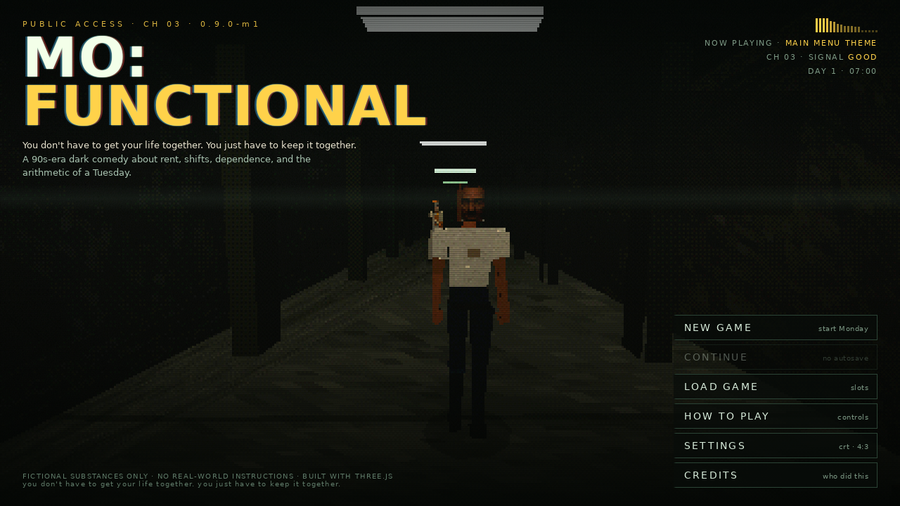
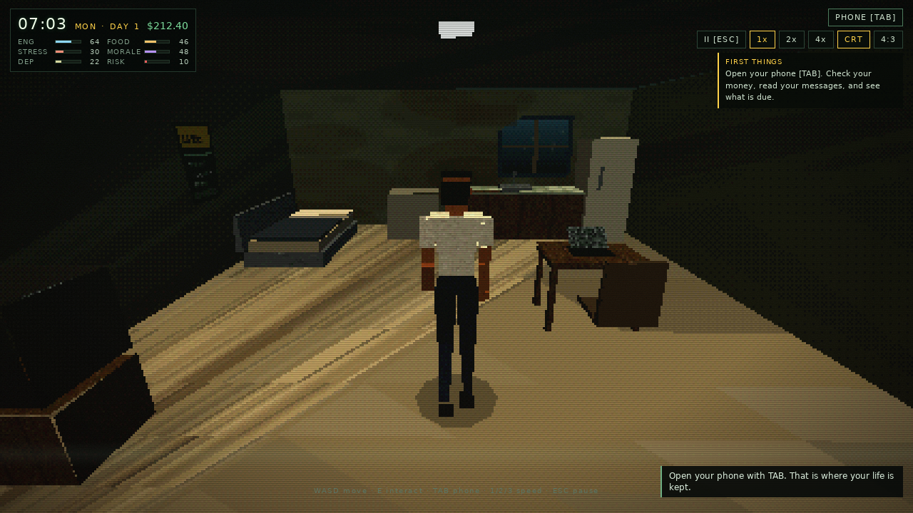
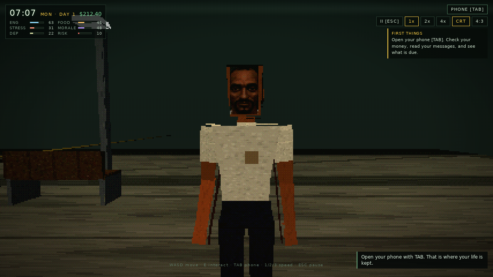
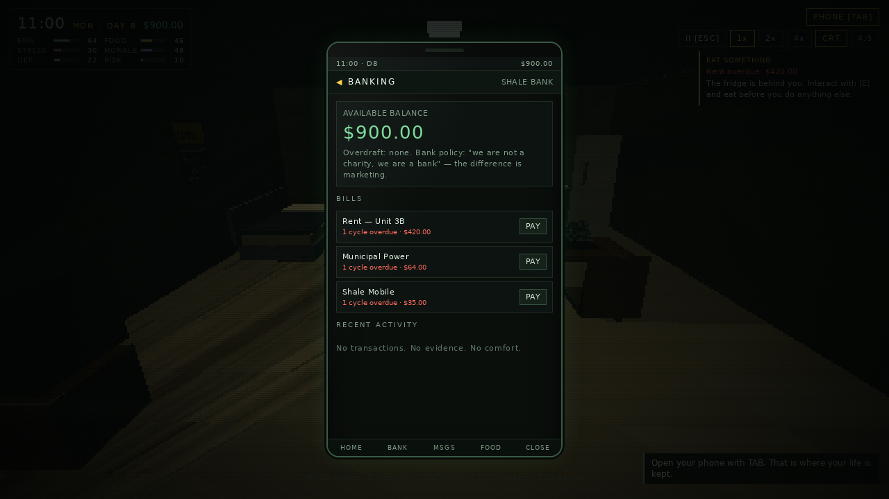
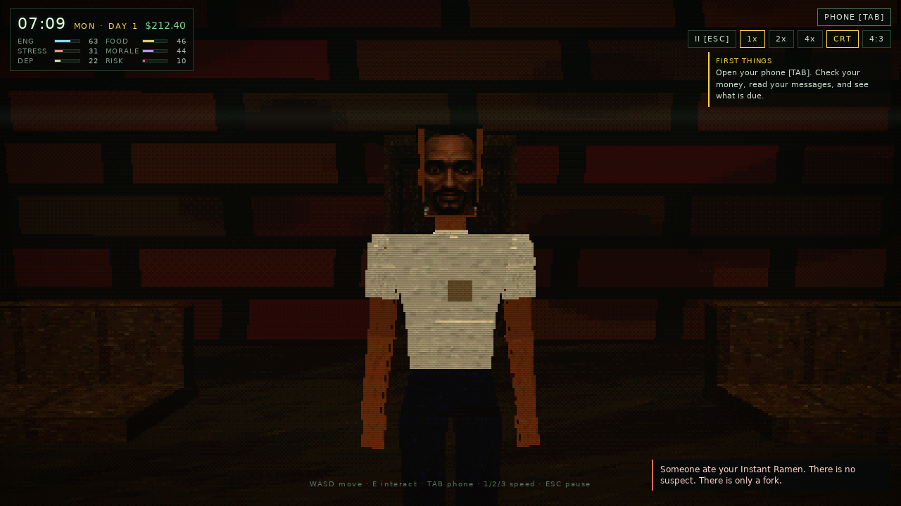
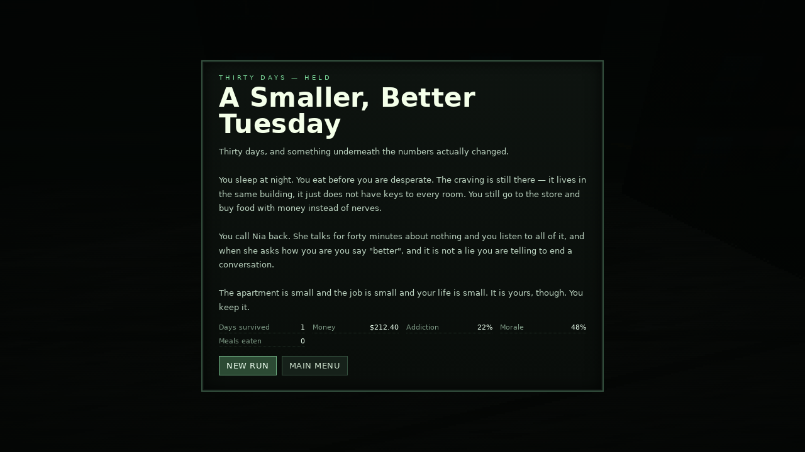

# MO: FUNCTIONAL

> *You don't have to get your life together. You just have to keep it together.*

A dark-comedy, PS1-inspired **life-management simulation** about rent, shifts, dependence,
and the arithmetic of a Tuesday. Built with Three.js and vanilla JavaScript. No backend, no
build step, no install.



```
Mo has a job, a lease, a phone full of people who want things,
and a habit that has been quietly rewriting his week.
Rent is due on Friday. It is Monday. He does not have it.
```

---

## Play it

**Live:** <https://xiondigital.net/mofunctional/> — GitHub Pages, straight from `main`.
**Arcade:** <https://xiondigital.net/arcade/> — the hub tile that launches it.

No install, no account, no backend. Click **PRESS START**, headphones recommended.

The game is a static site. ES modules can't load over `file://`, so to run it from a
checkout, serve the folder:

```bash
# any one of these
npm start                 # python3 -m http.server 8080
python3 -m http.server 8080
npx serve -l 8080 .
```

Then open **http://localhost:8080** and click **PRESS START**.

- Desktop Chrome / Firefox / Safari. Keyboard required.
- Audio starts on the first click (browser autoplay policy). The supplied track is the
  menu theme; it is routed through WebAudio for the reactive menu.
- Saves live in `localStorage` (3 slots + autosave), scoped to the origin it is served from.

---

## Controls

| Key | Action |
|---|---|
| `W A S D` / arrows | Move (camera-relative) |
| `E` | Interact with whatever is in front of you |
| `TAB` | Phone (pauses time) |
| `ESC` | Pause / close |
| `1` `2` `3` | Speed 1× · 2× · 4× |
| `F` | Toggle 4:3 framing |
| `C` | Toggle CRT scanlines |

The HUD has the same controls as buttons. The phone has its own bottom navigation.

---

## The loop

Every meaningful action costs **time**. Time is the only resource that does not care how
you feel.



- **09:00–17:00, Mon–Fri** you work at Quik-Stop #14 for $11.50/hr. Miss it and you collect
  strikes; three strikes is a firing. Slept in? Called out? The store does not care why.
- **Rent is $420 every 7 days.** Power is $64 every 14. The phone is $35 every 7. Your
  take-home from a full week of shifts is about $430 — the job alone does not pay the week.
- The gap is closed by **odd jobs**, by selling your own things on **BidBay**, by relief
  programs, or by accepting money from a man in a very white suit.



Everything is a trade. Sleep restores energy and eats the clock. A shift pays rent and
destroys your body. A good night out costs money you needed. The drawer costs everything,
slowly, and it is always open.

---

## Systems

| System | What it actually does |
|---|---|
| **Time** | Absolute in-game minutes. 1 real second = 2 / 4.5 / 9 in-game minutes. Phone and modals pause it. |
| **Needs** | Energy, hunger, hygiene, stress, morale. Each decays hourly; low needs inflate stress and suppress morale. |
| **Dependence** | Addiction, tolerance, withdrawal and risk. Tolerance blunts each dose while raising the risk it adds. Withdrawal drains energy and morale until you either use, or sweat it out. |
| **Overdose** | Risk 100 is an ending. Risk only falls while rested, fed and clean. Neglect raises it on its own. It is always visible on the HUD. |
| **Employment** | Shift windows, late penalties, call-outs, strikes, firing, quitting, rehire. |
| **Bills** | Rent / power / phone cycle accounting with arrears, reminders, eviction notices and a power cut. |
| **Odd jobs** | Five cash-today jobs, one each per day, with distinct body costs. |
| **BidBay** | List anything non-document at any price. Prices above ~135% of market value simply do not sell. |
| **Relief** | Civic Relief Program food credit (ID + lease, weekly recert) and a one-time emergency utility grant. |
| **The Fellowship** | Five-stage recruitment: invited → attendee → tither → inner circle → pledge. Free coffee, escalating cost. |
| **Events** | 17 conditional random events with real mechanical choices. |
| **Social** | FeedLove posting costs time, moves followers, can backfire or attract a small donation. |
| **Endings** | 11 endings, from *Everything At Once* to *A Smaller, Better Tuesday*. |

---

## The phone

The phone is the primary interface. It pauses time, which makes it a respite — and the
place where the bad news is delivered.




**Messages · Banking · Employment · BidBay · Calendar · Pantry · Inventory · Rent & Bills ·
FeedLove · Fellowship · System**

Every app is functional: pay bills, clock in (when you're at the store), list items, order
groceries with cash or relief credit, apply for assistance, read Addison's increasingly
specific emails, sleep through the Calendar, save the game.

---

## People

**Mo** — late thirties, white tee, grey-blue jeans, goatee, tired eyes. A jointed low-poly
rig on ~7.5-head proportions: tapered thighs and shins, separate upper arms, forearms and
hands, and hip, knee, ankle, shoulder and elbow pivots — so he stands and walks like a
person rather than a stack of cubes. His face is the supplied `assets/mo_face.png`
(embedded as base64, so it is never CORS-tainted), cropped and nearest-filtered to a
64×104 PS1 texture mapped onto the front of the skull. Procedural walk/idle cycle,
intoxication sway and stumble, sleep/sit poses, and a physics ragdoll reaction when the
body finally files its complaint.


**Addison Octavius** — priest and cult leader of **The Golden Fellowship**. White
double-breasted suit, gold tie and clip, gold pocket square and cufflinks, grey hair and
beard, a hand-waving dance that goes on slightly too long. Entirely fictional; inspired
only by a wardrobe reference. He never threatens. He offers.



Also: **Rae** (landlord, clipboard), **Dale** (manager, 54, ready paperwork), **Dex** (the
corner, cash only), **Kev** (coworker, loud), **Nia** (sister, calling), and **Chairman**
(cat, landlord by other means).

---

## Endings

Eleven, all reachable, none of them a moral:

`overdose` · `withered` · `evicted` · `terminated` · `pledge` · `empty` · `snapped` ·
`functional` · `quiet` · `steady` · `lucid`



The good ones require a full month of scheduling without leaning on the drawer. The best
one is deliberately hard.

---

## PS1 rendering

Everything is generated at runtime — procedural canvas textures, jointed tapered low-poly
rigs, and a single hand-written shader used by every surface:

- **Affine texture mapping** (`uv * w` in the vertex shader, divided back in the fragment)
- **Vertex snapping** to a 120-unit NDC grid
- **Vertex wobble** driven by a shared clock uniform
- **Two-light retro shading** — a warm key, a cool bounce, sky/ground hemisphere ambient
  and a camera-facing fill, so faces stay readable the way PS1 games faked it
- **4×4 ordered dithering** + 5-bit colour quantization
- **Height fog** that eats the draw distance
- **240p internal resolution**, nearest-filtered and upscaled
- CSS CRT layer: scanlines, vignette, rolling tracking bar, optional 4:3

No PBR, no antialiasing, no smooth normals, no HDRI.

---

## Architecture

```
index.html                 shell
styles/main.css            UI, CRT, phone, menu, endings
vendor/three.module.js     Three.js r169 (vendored, offline)

src/core/config.js         ALL balance + item/job/substance catalog
src/core/state.js          state shape, item/clock/money/log helpers
src/core/save.js           3 slots + autosave (localStorage)
src/core/audio.js          menu theme + WebAudio analyser + synthesized SFX
src/core/util.js           formatting/clamping helpers

src/systems/needs.js       simulate() — the only place time moves
src/systems/economy.js     bills, groceries, BidBay, relief, deliveries
src/systems/jobs.js        shifts, strikes, odd jobs, quitting
src/systems/events.js      17 events with choices
src/systems/fellowship.js  Addison's pipeline
src/systems/endings.js     11 endings + triggers
src/systems/dialogue.js    all prose

src/render/ps1.js          shader material, renderer, geometry helpers
src/render/textures.js     procedural textures (concrete, lino, faces, neon…)

src/world/characters.js    Mo / Addison / NPC / cat rigs + animation
src/world/areas.js         apartment, street, church, menu corridor + interactables
src/world/game3d.js        scenes, movement, camera, prompts, ragdoll

src/ui/hud.js              clock, needs, objective, toasts, controls
src/ui/phone.js            phone shell + 11 apps
src/ui/modal.js            choice modal
src/ui/menu.js             main menu, intro, settings, saves, credits, endings

docs/GAME_DESIGN.md        design bible + economy maths
docs/DEVLOG.md             changelog, directives, TODO / handoff
```

**Invariant:** `simulate(g, minutes, ctx)` in `src/systems/needs.js` is the only function
that advances the clock. Every action funnels through `Game.advance()`. Add a time cost
anywhere else and the day-boundary logic will miss it.

**Balance:** every number lives in `src/core/config.js`. Gameplay code never hardcodes a
price, wage, rate or threshold.

---

## Save data

`localStorage` key namespace `mofunctional.save.v2`, with slots `s1`–`s3` and `auto`.
Autosave runs every 60 in-game minutes when the game is running. No accounts, no network
requests, no analytics — the page loads only its own files plus the bundled font-free CSS
and the bundled track.

---

## Content note

This is fiction about addiction, poverty and housing insecurity, played as a dark comedy.
**All substances in the game are invented** (BLISS, STATIC, MUD, DRIP) and exist only as
numbers: tolerance, dependence, withdrawal, risk. There is no real-world drug information,
no dosing, no procurement detail, no violence, no weapons, and no real people or
organisations. Addison Octavius is an original fictional character; any resemblance to a
living person is unintended.

The joke is Mo's circumstances. The systems are not jokes.

---

## Status

**Milestone 1 — playable vertical slice of all four requested phases.** See
[docs/DEVLOG.md](docs/DEVLOG.md) for the changelog, verified checks, known rough edges and
the prioritised TODO.

Implemented: PS1 renderer · three areas + menu corridor · Mo and Addison rigs with
animation and ragdoll · clock/needs/dependence/risk · employment with strikes · bills and
arrears · odd jobs · BidBay · relief programs · Fellowship pipeline · 17 events · 11
endings · phone with 11 apps · save/load · audio-reactive menu with the supplied theme.

Not yet: touch controls, camera raycast against walls (it clamps instead), a recovery
chain, localisation extraction, accessibility options. Balance is analytic rather than
playtested across a full 30-day run — that is the top item in the handoff list.

Screenshots above were captured from the running build in headless Chromium with software
WebGL; colours are slightly flatter there than on hardware.

---

## Credits

- **Design, code, writing, world** — built in the Freebuff coding agent for **XiØN**.
- **Engine** — [Three.js](https://threejs.org) r169 (MIT), vendored.
- **Menu theme** — *“Mo Functional — Main Menu”*, supplied with this repository
  (`Music/Mo Functional_ Main Menu.mp3`, copied to `assets/audio/menu_theme.mp3`).
- **SFX** — synthesized at runtime with WebAudio (no audio files added).

Licensed MIT for the code. The supplied music remains the property of its creator.

> *You don't have to get your life together. You just have to keep it together.*
